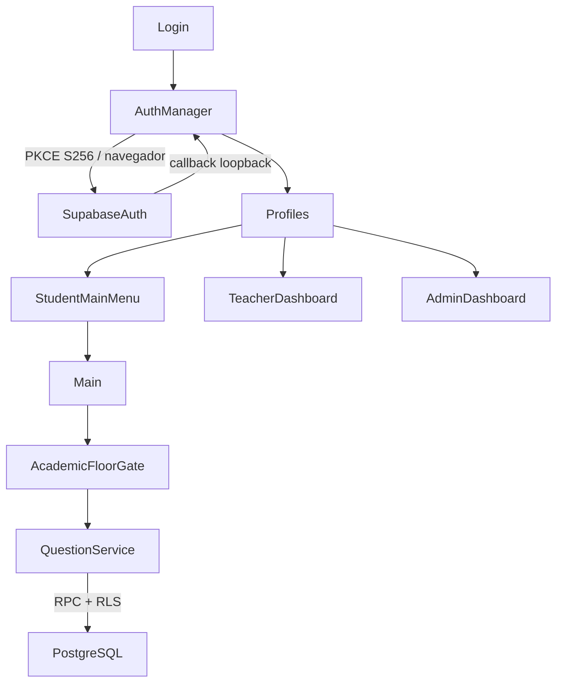

# DUOCGAMES EDUCATIVO 1.0 · autenticación

## Inicio manual y persistencia (2026-10-20)

El inicio muestra la portada por defecto. Login incluye «Mantener sesión iniciada»,
desmarcado inicialmente. Solo al marcarlo se guardan URL, refresh token rotatorio
y remember_login=true en user://education.auth-session.json; no se guardan
contraseña, access token, identidad ni rol. Las sesiones antiguas sin esa elección
se descartan silenciosamente. Sin marcarlo, los tokens solo duran en memoria.
Con consentimiento, el siguiente inicio intenta refresh y consulta profiles de
nuevo; cualquier fallo de restauración limpia la sesión y deja la portada limpia.
Google y registro no habilitan persistencia automáticamente.

Logout limpia tokens, expiración, identidad, avatar, perfil, rol y preferencia,
elimina la vista solicitada y pide revocación remota con scope=local. Permite
cambiar de cuenta sin reiniciar. Pruebas: remember_login_check.gd,
SupabaseAuthCheck, EmailRegistrationCheck y UserRolesCheck usan fixtures.

## Diagnóstico de registro después de aplicar SQL

Se comprobó en runtime la fuente `res://config/auth_config.json`, URL HTTPS con
host Supabase y clave publishable reconocida. Auth settings responde 200 y
permite Email/signup. Las seis tablas consultadas ya no responden 404: exigen
autenticación con 401 para la consulta anónima, consistente con los grants/RLS.

El intento válido del usuario que mostró «No se pudo conectar con el servidor»
no tenía diagnóstico de transporte guardado. Ese mensaje procedía de status 0,
que no distinguía un fallo al iniciar HTTPRequest, timeout, TLS o DNS. No se
atribuye retrospectivamente a una causa que no se registró.

Ahora debug registra solo configuración censurada, URL final, presencia de
headers/campos, longitud de contraseña, HTTP status, resultado de transporte,
duración, código y mensaje del servidor sanitizados. Release no imprime esos
datos. Contraseñas, claves, tokens y correos se redactan. El error_code de GoTrue
tiene prioridad sobre un code numérico. Los HTTP 400/401/403/422/429/500+ tienen
mensajes distintos de los errores de transporte; los de base de datos y SMTP
se distinguen de un fallo de conectividad.

Para comprobar el POST real sin crear usuarios se envió JSON malformado sin
parámetros de cuenta. Supabase respondió 400: «Could not parse request body as
JSON: unexpected end of JSON input». Es un rechazo intencional de diagnóstico,
**no el resultado de un registro válido ni la causa del error del usuario**.
No se enviaron registros válidos ni se crearon cuentas automáticamente.

El formulario conserva contraseña/confirmación si falla red, configuración o
validación del servidor. Solo las limpia tras éxito o al abandonar el formulario.
Las validaciones locales impiden enviar solicitudes inválidas. El diseño no
cambió. Evidencia vigente: `reports/signup_runtime_diagnostics.json` y
`reports/signup_diagnostics_unit.json`. Los estados anteriores 404 de la primera
conexión que se describen más abajo son históricos, previos a la migración.

Registro con correo: `register_email()` envía email, password y únicamente
`data.display_name` a `/auth/v1/signup`. El rol procede del trigger de profiles,
que asigna pending tras aplicar 004; nunca se acepta un rol desde el formulario. Si Supabase
requiere confirmación, se informa al usuario y se vuelve al formulario de acceso.
`login_email()` usa `/auth/v1/token?grant_type=password` y después carga el mismo
perfil/rol que Google. Una sesión inmediata de registro usa ese mismo camino.
Las contraseñas solo permanecen transitoriamente en memoria para la solicitud
HTTPS, no se persisten. Los campos se ocultan y se limpian solo después de un resultado exitoso; tampoco
se imprimen respuestas crudas del proveedor. Los datos de partida siguen locales.

## Configuración real y compatibilidad

La configuración encontrada en el archivo de ejemplo se conservó en
`config/auth_config.json`; el ejemplo volvió a ser una plantilla sin valores
reales. El archivo real está ignorado por Git y excluido de exportaciones.

Orden de archivos: `DUOCGAMES_AUTH_CONFIG` si existe, después
`user://auth_config.json` y finalmente `res://config/auth_config.json`.
El primer archivo existente se usa como fuente; un JSON inválido no se oculta
con otra configuración. El ejemplo nunca se carga automáticamente.

Propiedades: `supabase_url`, preferentemente `supabase_publishable_key`,
compatibilidad `supabase_anon_key`, `google_enabled`, `oauth_callback_port`.
La propiedad preferida no vacía tiene prioridad. La compatibilidad se refiere
al nombre antiguo: su valor también debe ser una clave `sb_publishable_…`.
No se aceptan API keys JWT, claves secretas ni credenciales en la URL.
La URL debe ser HTTPS. Nunca se imprimen configuración, headers ni respuestas
crudas. Los redirects HTTP están deshabilitados para no reenviar la clave.

Las peticiones mandan la clave pública únicamente en `apikey` y el JWT de
sesión únicamente en `Authorization: Bearer`, cuando corresponde. No hay
contraseñas en el save de sesión. Al renovar se persiste el refresh token
rotativo; una renovación fallida elimina la sesión local. El logout limpia
primero el estado local e intenta revocar la sesión remota.

El perfil debe existir, corresponder al ID autenticado y contener un rol válido.
Un perfil ausente, discordante o de rol desconocido bloquea el acceso. El juego
no crea perfiles ni permite seleccionar rol. El trigger acepta display_name y
conserva full_name como compatibilidad de Google/registros anteriores.

La prueba GET inicial de Auth devolvió HTTP 200. Antes de aplicar SQL las tablas educativas devolvieron
404 (ausentes o fuera de caché); no se verificó la aplicación remota del SQL ni
RLS con cuentas reales. No se ejecutó DDL ni se crearon usuarios remotamente.
Primero ejecutar `supabase/migrations/001_education_auth.sql` en SQL Editor.
Si una instalación ya tenía el 001 anterior, usar el parche
`002_profile_display_name.sql` en vez de repetir una migración inicial aplicada.
`supabase/verify_education_auth.sql` contiene consultas administrativas de solo
lectura para verificar tablas, RLS, trigger y privilegios después de migrar.

Fuentes oficiales:
https://supabase.com/docs/guides/getting-started/api-keys
https://supabase.com/docs/guides/auth/managing-user-data

## Auditoría previa y decisiones

Antes, `project.godot` ejecutaba `Main.tscn`. `GameplayManager` creaba jugador,
cámara y HUD; `CampusCampaign._boot()` cargaba la campaña y abría el diálogo
Continuar/Nueva partida. Ahora F5 abre `scenes/education/Login.tscn`. No se
instancia el campus hasta seleccionar Continuar o Nueva partida como estudiante.
F6 sobre Main conserva el acceso directo de desarrollo y las pruebas antiguas.

Login y StudentMainMenu muestran como fondo una captura de la entrada del campus
existente (`resources/ui/campus_login.png`). El campus jugable solo se carga al
seleccionar Continuar o Nueva partida; el fondo no inicia la campaña ni toca saves.

Se revisaron Main, `campus_campaign.gd`, `campaign_ui.gd`, `quest_manager.gd`,
`student_phone.gd`, `campus_state.gd`, `campus_settings.gd`,
`campus_localization.gd`, `save_migration.gd`, `lectura_guardado.gd`,
`ascensor_estudiantil.gd` y las fichas/scripts del Piso 3. El celular y los
diálogos pertenecen a la campaña; no son el nuevo sistema de identidad.
CampusState sigue derivando las fases narrativas de NEXO. Configuración e idioma
de la campaña permanecen en sus sistemas actuales. La UI educativa inicial es
española; su traducción completa queda pendiente.

La geometría de Main, escaleras, cabinas, misiones, inventario, computadores y
bosses no se redistribuye. El desbloqueo educativo es adicional al desbloqueo
argumental del ascensor, que conserva sus requisitos actuales.

## Flujo

Autoloads nuevos: AuthManager y QuestionService. Los otros sistemas continúan
creándose dentro de la campaña. Las cuatro escenas educativas usan
`education_shell.gd`; los paneles no contienen credenciales ni lógica de permisos
de base de datos.

## Sesión y OAuth

AuthManager conserva en memoria user_id, email, display_name, avatar_url, role,
access_token, refresh_token y expires_at. Solo acepta el rol de `profiles`, nunca
el metadata de Google ni un dropdown del juego. Las sesiones DEV solo funcionan
con `OS.is_debug_build()` y nunca se guardan ni se envían al backend.

Al arrancar intenta renovar el refresh token existente. Durante la sesión
revisa periódicamente la expiración y renueva antes de vencer. Una renovación
fallida limpia la sesión. El logout limpia primero el cliente e intenta revocar
la sesión remota; si no hay conexión, la revocación remota puede no completarse.

PKCE: 64 bytes aleatorios criptográficos → verifier base64url → SHA256 →
challenge base64url. Listener TCP solo en 127.0.0.1, puerto configurable,
nonce aleatorio en el redirect de aplicación, comprobación de método/ruta/Host,
sin Origin, cabeceras limitadas a 8 KiB, cliente lento limitado a 3 segundos y
flujo a 180 segundos. No se sobreescribe el state que Supabase usa con Google.
El navegador recibe una página sin scripts. Se cierra el listener antes de
intercambiar el code. Verifier y code no se persisten ni se reutilizan.
PKCE enlaza el código con el dispositivo que inició el flujo.

Almacén de sesión: `user://education.auth-session.json`, separado de la campaña.
Contiene únicamente URL del proyecto y refresh token rotativo. Es un archivo
local sensible protegido por los permisos de la cuenta de Windows, **no un
almacén cifrado del sistema**. Antes de un despliegue institucional compartido
conviene reemplazar este adaptador por Windows Credential Manager/DPAPI; cifrar
con una clave incluida en el juego no resolvería ese problema.

## Guardados y compatibilidad

Se conserva `config/custom_user_dir_name="Piso y Personaje Basico"` y
`user://campus_campaign_v1.json`. No se cambia el propietario ni se elimina el
save al entrar o salir de una cuenta. Nueva partida sigue pasando por la
personalización y el reemplazo con `.bak` existentes. La migración agrega
`academic_floor_unlocks` y `academic_progress` de forma aditiva, sin reabrir
misiones completadas ni alterar NEXO. Se conserva save_version 2 porque la
extensión usa campos opcionales y mantiene compatible el lector existente.

El save sigue siendo local y compartido entre cuentas que usen la misma cuenta
de Windows. No hay todavía asociación local_save ↔ user_id ni sincronización de
inventario/campaña. No debe presentarse el progreso local como evidencia de una
evaluación oficial. Los intentos autenticados sí están vinculados a auth.uid().

## Referencias verificadas

- https://supabase.com/docs/guides/auth/sessions/pkce-flow
- https://supabase.com/docs/guides/auth/social-login/auth-google
- https://supabase.com/docs/guides/database/postgres/row-level-security

Google OAuth y los permisos de una instancia real requieren configuración y
pruebas externas. Que el código compile no demuestra que OAuth esté operativo.

## Login y menú inicial 2.0

La restauración inicial es silenciosa. Un refresh inválido elimina únicamente
`user://education.auth-session.json`, limpia identidad/tokens y vuelve al login.
El login manual usa directamente `grant_type=password`; no restaura primero una
sesión anterior. Persiste el nuevo refresh token antes de consultar el perfil.
Nunca persiste contraseñas ni mezcla tokens con el guardado de campaña.

La expiración usa `expires_in` positivo sumado al Unix timestamp en segundos.
Como compatibilidad acepta `expires_at` y normaliza milisegundos. Un
`expires_at` nulo/cero no invalida una respuesta con `expires_in` válido.
La condición anterior podía rechazarla; no se capturó la respuesta de la cuenta
real y por tanto no se afirma que esa fuera su causa exacta.

Auth y perfil son estados separados: `session_valid()` comprueba la sesión;
`can_enter_menu()` exige además un perfil válido y su rol autorizado. Si falla
profiles, conserva los tokens válidos pero bloquea el menú. Un rol desconocido
no recibe permisos. Logout limpia también el caché de perfil.

Logs seguros: `[AUTH_LOGIN]`, `[AUTH_REFRESH]`, `[AUTH_PROFILE]`, `[AUTH_ROUTE]`.
Incluyen HTTP/resultado, nunca tokens, contraseñas ni claves. Para diagnosticar,
enviar estas líneas y el diagnóstico AUTH HTTP sanitizado, sin copiar archivos
de sesión o configuración.

Si un usuario de Authentication carece de profile, revisar en SQL Editor con
acceso administrativo y aplicar `supabase/migrations/003_recover_missing_profiles.sql`.
Es idempotente: inserta solamente perfiles faltantes con role student y repara
el trigger education_profile; conserva perfiles/roles existentes. No fue
aplicada remotamente desde Godot ni se inspeccionó una cuenta con contraseña.

## Roles definitivos

El registro único crea pending tras 004. route_authenticated_user centraliza los cuatro roles. PendingAccountScreen consulta el estado sin cambiar permisos. AdminService usa RPC verificadas en PostgreSQL, no UPDATE profiles. Ver ROLE_SYSTEM.md y ADMIN_PANEL.md. No reaplicar 002/003 después de 004: contienen el trigger histórico student.
