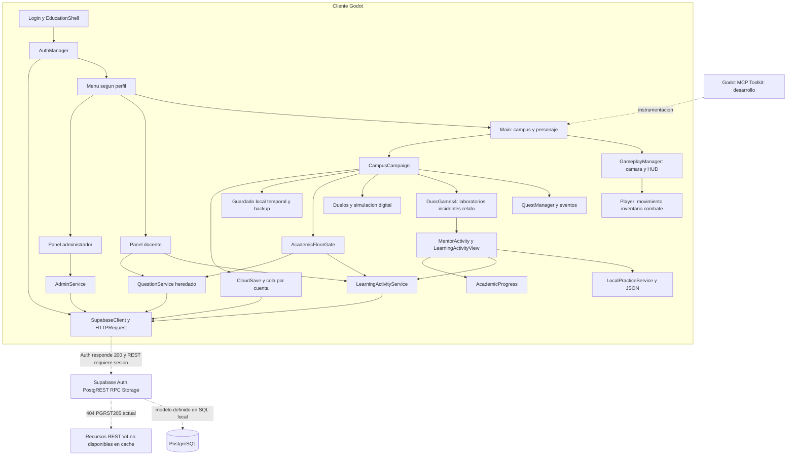
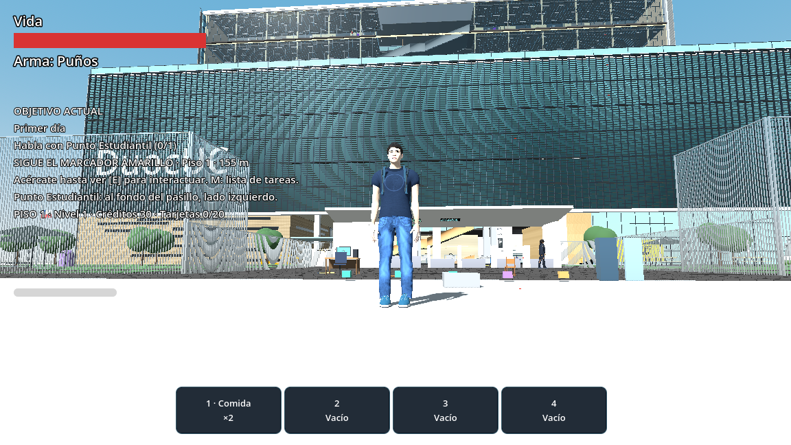

# DuocGames — auditoría real para presentación Capstone

**Revisión actualizada: 6 de noviembre de 2026, con inspección Godot MCP y consultas HTTP reales. Presentadores: Nicolás Hernández y Giannela Gajardo.**

Este informe sustituye el documento previo de esta misma ruta. Distingue las comprobaciones actuales de las ejecuciones registradas anteriormente. No se desarrollaron funcionalidades, corrigieron scripts, modificaron escenas, aplicaron migraciones, crearon cuentas ni realizaron commits o push.

### Método y límites de verificación

- **C — Confirmado en código/configuración:** hay implementación concreta; no significa funcionamiento completo comprobado.
- **H — Evidencia histórica:** existe un resultado, log o captura anterior; no se atribuye su ejecución a esta auditoría.
- **E — Observado en esta revisión:** consulta real al editor/runtime, validación estática o respuesta HTTP actual, con su alcance indicado. Observar un nodo no prueba todas sus interacciones.
- **P — Parcial:** implementación existente con integración o validación incompleta.
- **D — Documentado/propuesto:** intención o recomendación sin funcionamiento demostrado.
- **NV — No verificable en esta revisión.**

Se revisaron GDScript, escenas TSCN, configuración, SQL, JSON, recursos e historial Git. La conexión MCP inicial a la carpeta Aethergate devolvió AUTH_FAILED; se resolvió el enrutamiento usando el **puente oficial de Godot MCP Toolkit ya instalado, dirigido explícitamente a Aethergate/Juego**. No se cambió la configuración del proyecto ni se creó un script auxiliar. Se observaron el editor y una instancia de Main ya en ejecución, y se obtuvieron dos PNG nuevos. Se visualizaron los nueve PNG históricos de pisos y las nuevas capturas; las cuatro capturas de campus/pregunta/paneles revisadas en la auditoría anterior conservan esa procedencia histórica.

**Se validaron estáticamente los 221 archivos .gd de scripts/ mediante script_check: 221 válidos y cero fallos.** No se ejecutaron suites de comportamiento, login con una cuenta, SQL directo, exportaciones ni una campaña manual completa. La comprobación global por LSP se intentó, pero devolvió LSP_UNAVAILABLE en el puerto 6005; no se presenta como aprobada. El barrido script_check excluye tests/ y addons/.

**Supabase actual:** GET /auth/v1/settings respondió 200, con proveedor email habilitado y registro permitido. La raíz REST y nueve endpoints de tablas heredadas/administración/guardado respondieron 401 sin sesión. Los tres recursos V4 learning_activities, learning_attempts y learning_access respondieron **404 con código PGRST205**, por lo que no están disponibles en la caché de esquema de la API consultada. No se concluye que esas tablas falten físicamente en todo PostgreSQL ni se certifican RLS o filas a partir de respuestas anónimas. El fallo DNS registrado anteriormente queda como antecedente superado para esta consulta.

El runtime observado tenía persist=true y test_mode=false. Para respetar la prohibición de alterar datos existentes, se usaron expresiones de lectura y capturas: no se respondió una pregunta, movió al jugador, cambió de escena ni invocó save_game desde la auditoría. La simulación ya abierta podía continuar sus procesos propios. La instancia dejó de estar disponible en una consulta posterior (GAME_NOT_RUNNING); no hay evidencia suficiente para atribuirlo a un crash. Los resultados funcionales anteriores se mantienen identificados como históricos.

Las rutas son relativas a `Juego/`. No se reproducen credenciales, tokens, correos personales ni valores de configuración privados. Los personajes y horarios del juego son ficticios. El estado local incluye numerosos cambios previos sin commit: HEAD no representa por sí solo todos los archivos auditados.

## 1. Presentación

**Información comprobada.** DuocGames es un videojuego 3D de escritorio construido en Godot. Por sus mecánicas puede describirse como aventura de exploración en tercera persona con acción, campaña y práctica educativa. Esta clasificación es una interpretación de la implementación, no una categoría comercial certificada. El campus contiene nueve niveles: −1 y 1–8; no se está contando un piso 0.

El estudiante recorre espacios, conversa, acepta encargos, recoge recursos, usa inventario y resuelve actividades. Su objetivo narrativo es ayudar a recuperar el campus durante el incidente ficticio NEXO. Las preguntas conviven con exploración, objetivos, rescates, acceso a zonas, simulaciones digitales y persistencia. Eso lo diferencia técnicamente de una sucesión convencional de formularios; no demuestra que sea pedagógicamente superior.

**Objetivo educativo:** ofrecer práctica complementaria y retroalimentación por asignatura. No se verificaron mejoras de notas, eficacia pedagógica, validación curricular ni condición de producto oficial de Duoc UC.

**Evidencia:** `project.godot`, `Main.tscn`, `scripts/juego/player.gd`, `scripts/campaign/campus_campaign.gd`, `scripts/education/nexo_story_v4.gd`, `mentor_activity_v4.gd`.

**Funciones reales / pendientes:** cliente y contenido local (C/H); validación pedagógica y operación integral remota (P/NV).

**PowerPoint:** «DuocGames: campus virtual 3D con exploración, campaña y práctica educativa. Proyecto Capstone de Ingeniería en Informática».

**Oral — Nicolás:** «El estudiante entra a un campus virtual, conversa con personajes y practica contenidos dentro de una aventura. Presentaremos las funciones construidas y lo que todavía necesita validación».

**Imagen:** [campus y protagonista actuales](reports/capstone_capturas/actual_runtime_campus.png), obtenida por MCP en una instancia ya abierta. [Captura anterior de mentor](reports/capstone_capturas/01_campus_demo.png) proviene de inicio diagnóstico en piso 3, no del comienzo normal de campaña.

## 2. Equipo

**Información comprobada:** Nicolás Hernández y Giannela Gajardo son los nombres indicados por el solicitante. Git contiene registros del proyecto, pero no demuestra reparto individual de sistemas, horas ni porcentajes de participación.

**Evidencia:** instrucción de auditoría e historial `git log`. Un nombre de autor o el uso de una herramienta no prueba autoría exclusiva de un componente.

**Funciones reales / pendientes:** presentadores identificados; responsabilidades históricas, profesor guía y sección académica deben completarse con evidencia del equipo.

**PowerPoint:** «Nicolás Hernández · Giannela Gajardo».

**Oral — Giannela:** «Presentaremos entre ambos la experiencia, la arquitectura y la evidencia. El reparto de exposición no representa una atribución histórica de todo el desarrollo».

**Imagen:** nombres y reparto propuesto: Nicolás explica solución/arquitectura/demo; Giannela, datos/pruebas/limitaciones. No generar retratos ficticios.

## 3. Contexto

**Información comprobada:** el proyecto distribuye Informática y Telecomunicaciones en piso 3, Salud y sector docente en 4, servicios en los primeros pisos, formación general en superiores y talleres técnicos en −1. `AGENTS.md` fija esa temática; no se debe deducir otra facultad a partir de un nodo antiguo.

El seed y banco local utilizan `INF_GENERAL`, `BASE_DATOS`, `ALGORITMOS`, `REDES`, `INGLES`, `ETICA`, `COMUNICACION`, `MATEMATICAS`, `ENFERMERIA` y `ODONTOLOGIA`. Son códigos del proyecto, no una malla institucional validada.

**Evidencia:** `AGENTS.md`, `supabase/seeds/001_subjects.sql`, `resources/education/capstone_practice_bank.json`, `scripts/campaign/academic_expansion_data.gd`.

**Funciones reales / pendientes:** organización temática en implementación (C); correspondencia curricular oficial y diagnóstico institucional (NV).

**PowerPoint:** «Práctica complementaria por asignatura en un campus ficticio. Contenidos y horarios del juego sujetos a revisión docente».

**Oral — Nicolás:** «Usamos espacios y asignaturas reconocibles para dar contexto. La distribución pertenece al juego y no certifica planos ni horarios de una sede».

**Imagen:** tabla de pisos de la sección 7.

## 4. Problemática

**Información comprobada:** el producto aborda la integración técnica de campus, progresión y contenido académico administrable. El código contempla fallos de red, perfiles pendientes, guardado inválido, duplicación de respuestas y separación de práctica frente a evaluación remota.

La hipótesis pedagógica es que contexto, exploración y explicación inmediata pueden complementar el estudio. No hay evidencia revisada para afirmar desmotivación generalizada, fracaso de los cuestionarios tradicionales, adopción real o mejoras académicas causadas por DuocGames.

**Evidencia:** `scripts/auth/auth_manager.gd`, `scripts/education/learning_activity_service.gd`, `local_practice_service.gd`, `cloud_save.gd`, `scripts/compartidos/lectura_guardado.gd` y fixtures de `tests/`.

**Funciones reales / pendientes:** tratamiento técnico de esos casos (C/H); validar la necesidad y utilidad educativa con personas (D/NV).

**PowerPoint:** «Desafío: integrar práctica, retroalimentación y progresión en una experiencia explorable. Hipótesis educativa pendiente de evaluar con usuarios».

**Oral — Giannela:** «Podemos explicar el problema de integración resuelto técnicamente. La utilidad académica debe comprobarse con docentes y estudiantes antes de afirmar resultados».

**Imagen:** pregunta y explicación auténticas, sin porcentajes de mejora inventados.

## 5. Solución

### Inicio, avance, recompensas y derrota

La entrada configurada es `res://scenes/education/Login.tscn`, no `Main.tscn`. `AuthManager` comprueba sesión/perfil y `EducationShell` enruta a cuenta pendiente, menú estudiante o panel según rol. El menú estudiante ofrece continuar, nueva partida, progreso, ajustes y cierre de sesión. En cuenta real consulta guardado remoto antes de habilitar operaciones; la sesión de desarrollo tiene condiciones diferentes.

Al entrar al campus, `CampusCampaign` inicializa jugador, datos, misiones, accesos y sistemas adicionales. La primera misión es «Primer día»: hablar con Punto Estudiantil, recoger un objeto, completar el computador inicial y superar los encuentros indicados. `QuestManager.objective_text()` produce el objetivo visible; la guía orienta al jugador.

Las misiones procesan eventos de conversación, recogida, entrega, computador, puerta o desafío. Al cumplir requisitos no opcionales, se completan y entregan créditos, XP, ítems o destinos según definición. `grant_reward()` marca la fuente para evitar repetir premios. XP de campaña y `educational_xp` son datos distintos; ninguno constituye nota institucional.

Al caer, hay menú de checkpoint o retorno al menú. En duelos existe reintento con restauración de recursos previos; fuera de ese caso el mensaje indica que se conservan objetos/progreso. `restore_player`, `respawn` y el sistema de reintentos implementan el flujo. No se verificó manualmente cada transición aquí.

El Director no es por sí solo el cierre de toda la campaña: después siguen archivo subterráneo, núcleo NEXO y epílogo. El código permite continuar explorando después del desenlace.

**Evidencia:** `project.godot`, `education_shell.gd`, `campus_campaign.gd`, `quest_manager.gd`, `mission_guidance.gd`, `nexo_story_v4.gd`, pruebas de campaña.

**Funciones reales / pendientes:** ciclo presente en código y regresiones previas (C/H); inicio autenticado → campaña completa → sincronización real (P/NV).

**PowerPoint:** «Entrar → explorar → conversar → practicar y resolver → recibir explicación → progresar y guardar».

**Oral — Nicolás:** «Las preguntas forman parte de una experiencia con objetivos y recursos. Completar una misión puede abrir destinos; una práctica local no se presenta como validación del servidor».

**Imagen:** `02_dialogo_profesor.png`, `03_pregunta_demo.png`, `04_respuesta_demo.png`.

## 6. Objetivos

**Objetivo general reconstruido del producto:** integrar exploración de campus 3D, campaña y práctica educativa con identidad de usuario y administración de contenidos. No se presenta como especificación firmada.

| Objetivo específico | Evidencia de implementación | Pendiente |
|---|---|---|
| Campus explorable | Main, Player y cámara | Recorrido manual completo |
| Práctica por asignatura | Mentores, banco y servicios | Revisión curricular |
| Evaluación y explicación | LearningActivityView y MentorActivity | Flujo remoto real |
| Administración por rol | Shell, paneles y RPC SQL | Permisos efectivos desplegados |
| Conservar progreso | JSON, respaldos y CloudSave | Sincronización real y dos dispositivos |
| Demostración verificable | CapstoneDemo y PNG previos | Grabación nueva y ruta normal |

**Funciones reales / pendientes:** objetivos técnicos con componentes concretos (C/H); aceptación y eficacia educativa (D/NV).

**PowerPoint:** «Explorar · Practicar · Recibir explicación · Administrar contenidos · Conservar progreso».

**Oral — Giannela:** «Relacionamos los objetivos con componentes reales. La evaluación del aprendizaje y la aceptación institucional necesitan evidencia adicional».

**Imagen:** mapa entre objetivos y componentes de la tabla.

## 7. Alcance

### 7.1 Inventario de jugabilidad

Ninguna fila implica funcionamiento completo probado durante esta revisión. C/H significa **implementación local existente con evidencia previa**, no una propuesta; P señala integración parcial y D una propuesta. No se otorga la etiqueta «completa de principio a fin» a un flujo que no fue recorrido íntegramente. La disponibilidad de nodos observada ahora se precisa en 7.8. Un ejemplo explícito de extensión futura es DuelType.FUTURE_TYPE sin start_method: el controlador informa que está preparado para un desafío futuro y cancela; ese gancho no se cuenta como minijuego funcional.

| Mecánica | Qué hace y cómo funciona | Dónde/evidencia | Estado y límite |
|---|---|---|---|
| Movimiento | CharacterBody3D, gravedad/colisiones y dirección relativa a cámara; caminar 2,5, correr 5,5, agachado 1,3; salto con impulso 5,0 | `scripts/juego/player.gd`, campus | C/H; constantes de control, no rendimiento |
| Cámara | Ratón para yaw/pitch, seguimiento suavizado, zoom 2,5–9 y resolución de obstáculos | `gameplay_manager.gd`, `camera_obstruction.gd` | C/H; sin recorrido visual nuevo |
| Exploración | Nueve cotas, salas, áreas, objetos, secretos y tarjetas | Main, `campus_content.gd` | C/H; no toda sala tiene ejercicio propio |
| Interacción | Scanner selecciona objetivo y ejecuta acción; aviso E y comprobación de alcance | `interaction_controller.gd` | C/H; scanner usado en demo previa |
| Diálogo | Modales con opciones/callbacks y cámara contextual | `campaign_ui.gd`, `dialogue_camera_controller.gd`, `npc.gd` | C/H; voces completas no verificadas |
| Combate | Golpes, alcance, daño/empujes, ataques enemigos y duelos | Player, `player_combat.gd`, controladores | C/H; mentor separado del objetivo digital |
| Armas | Recoger/equipar/soltar; daño/durabilidad e implementos lanzables | `weapon.gd`, `campus_weapon.gd`, `weapon_pickup.gd`, `proyectil_deportivo.gd` | C/H; no todas probadas aquí |
| Inventario | Cantidades, equipamiento, consumibles y objetos de acceso; mochila/ranuras | Scripts de inventario, Player y HUD | C/H; regresiones previas |
| Salud/daño | Base máxima/inicial 100, curación, estaciones y muerte; asistencia puede reducir daño y evitar llegar a cero | Player, `health_station.gd`, `accessibility_v4.gd` | C/H; progresión modifica parámetros |
| Recompensas | Créditos, XP, objetos, cosméticos; registro por fuente evita duplicados | Campaign y `academic_expansion_data.gd` | C/H; práctica local sin premios oficiales |
| Experiencia | XP de juego/mejoras y XP educativa separada | Campaign y AcademicProgress | C/H; no notas académicas |
| Misiones/objetivos | Definiciones, prerrequisitos, requisitos por evento y estados; panel M | QuestManager, QuestUI | C/H; texto heredado no siempre describe requisitos finales |
| Guardado local | JSON, temporal y respaldo .bak; migración de estructuras | Campaign, `lectura_guardado.gd` | C/H; no se leyó guardado personal |
| Guardado cuenta | Cola/reintento, revisión, request_id y separación por usuario/proyecto | CloudSave, migración 007 | P; extremo a extremo remoto NV |
| Desbloqueos | Destinos por campaña, puertas por objetos y guardia educativo por llegada a piso | `floor_unlocked`, `locked_access.gd`, `academic_floor_gate.gd` | C/P; tres controles distintos |
| Ascensores | Cabinas/puertas y destino según progreso | `SistemasCompartidos/AscensoresEstudiantiles`, `ascensor_estudiantil.gd`, `elevator_interaction.gd` | C/H; todos los viajes manuales NV |
| Escaleras | Geometría física central y de emergencia entre niveles | Main y scripts compartidos | C/H; puede intervenir guardia educativo por altura |
| Minijuegos | Archivos, antivirus, contraseña y variantes temáticas | `minigame_ui.gd`, `game_files.gd`, `game_virus.gd`, `game_password.gd`, `campus_activity.gd` | C/H; no equivalen al banco publicado |
| Educación | Preguntas/secuencias; evaluación local o RPC según fuente | `scripts/education/` | C/H local; publicado P/NV |
| Celular/horarios | Contactos, mensajes y reloj/horario ficticio | `student_phone.gd`, `phone_view.gd`, `academic_schedule.gd` | C/H; no mensajes a personas reales |
| Personalización | Aspecto/cosméticos ligados a datos de campaña | `appearance_menu.gd`, `character_appearance.gd` | C/H; no herramienta de modelado |
| Sentarse/contexto | Puntos de asiento, poses y comprobación de espacio | `seat_interactable.gd`, `player_seating.gd`, `contextual_pose.gd` | C/H; aceptación total pendiente |

**Controles confirmados en Player:** W/A/S/D o flechas, Espacio salto, C/Ctrl agacharse, Shift correr, J golpe, E interacción, G soltar y Q lanzamiento deportivo. PlayerCombat incorpora Alt para esquivar y clic izquierdo mantenido para cargar golpe. Un golpe fuerte requiere carga de al menos 0,45 s y 30 de stamina; multiplica ataque por 1,8. Stamina base 100, consumo al correr y recuperación están implementados. Son parámetros leídos, no mediciones de una sesión actual.

**Inventario y recursos concretos:** `scripts/inventory/inventory.gd` implementa entradas con UID, favoritos, cuatro ranuras rápidas, arma equipada y almacenamiento de armas; su archivo heredado es `user://inventario_estudiante.json`. `item_catalog.gd` define bebida (+10 salud), comida (+30), botiquín (+50), colación de curación completa y bebida energética (+35% velocidad durante 12 s, renovable sin acumular potencia). Incluye útiles, llaves/tarjetas, libros/documentos, implementos deportivos y armas como escoba, bandeja, libro pesado, herramienta, teclado, cable, llave inglesa y extintor. El USB infectado prevé pulso a enemigo compatible con alcance/línea de visión. No todo objeto del catálogo está necesariamente colocado o accesible en una partida concreta.

**Recompensas académicas codificadas:** LlaveDeDatos añade pista en pruebas del Director; DepuradorPortatil reduce ralentizaciones; KitClinicoMejorado mejora botiquines; ProtectorDental reduce empuje, no daño; MapaDocente agrega sectores de contactos conocidos; AudifonosDeTraduccion amplía tiempo; InsigniaDeIntegridad reduce ralentizaciones; InsigniaDeOratoria entrega colación por misión de ayuda una sola vez; CalculadoraAvanzada agrega información temporal/pistas, sin responder automáticamente. Estas definiciones de `academic_expansion_data.gd` no equivalen a recompensas oficiales por práctica local.

### 7.2 Campaña, historia y misiones

`nexo_story_v4.gd` contiene cinco capítulos y epílogo: interrupción de NEXO; aprender para reparar; respuesta del campus; evaluación integradora; núcleo industrial; recuperación del instituto. NEXO bloquea accesos y altera simulaciones. El protagonista ayuda a compañeros con docentes aliados.

El capítulo depende del estado: bibliotecaria superada → II; Datos o Algoritmos → III; desbloqueo del 8 → IV; Director → V; NEXO → epílogo. Son banderas del juego, no certificaciones de asignaturas. Hay cierre narrativo integrado en código, sin observación actual del desenlace.

**Cadena principal efectiva de `quest_manager.gd`, después de los ajustes de `_ready()`:**

| ID | Requisitos relevantes | Recompensa definida |
|---|---|---|
| `inicio` | Punto, primer objeto, pc_intro, encuentros Punto y Chef | 60 créditos, 100 XP, destino 2 |
| `biblioteca` | Visitar 2, tres libros y bibliotecaria | 60/120, destino 3 |
| `academico3` | Visitar 3, pc3 y Datos o Algoritmos | 40/80, destino 4 |
| `academico4` | Visitar 4 y pc4 | 40/80, destino 5 |
| `academico5` | Visitar 5; pc5 opcional; se retiran bosses obligatorios | 40/80, destino 6 |
| `seguridad6` | Visitar 6; pc6 opcional; encuentros opcionales | 60/100, destino 7 |
| `acceso7` | Abrir acceso7 con TarjetaAcceso y visitar 7; pc7 opcional | 80/120, destino 8 |
| `direccion` | Director y tareas conexión/antivirus/configuración; pc8 opcional | 150/250, destino S |
| `postgame` | Archivo subterráneo | 100/200 |
| `nexo_final` | Puerta nexo_core y NEXO desactivado | Diccionario de premio de misión vacío; cierre narrativo |

Los textos iniciales conservan «vence», «duelo de acción» o ubicaciones antiguas. El método modifica requisitos posteriormente: no basta leer sus primeras líneas. No describir Inglés como requisito obligatorio de academico5: ese requisito se elimina.

**Secundarias:** llaves del auxiliar (25 créditos/40 XP y botiquín), cargador (20/30 y bebida energética), documentos del profesor 3 al funcionario 5 (40/70 y TarjetaAcceso), implementos deportivos (35/50 y paleta), computador infectado (30/50 y USB), casino (15/25), ubicar profesores y tres tareas del Director. Ubicar profesores requiere hablar con Algoritmos 3, Inglés 6 y Matemáticas 7 y regresar al coordinador; no derrotarlos. DuocGames4 agrega credencial académica de coordinación al completarse.

**Incidentes V4:** rescate sala 306 (piso 3, siete pasos), laboratorio sin conexión (3), programa infectado (3), emergencia simulada (4), presentación interrumpida (2), taller descontrolado (−1). `incidents_v4.tres` define pasos; `educational_missions_v4.gd` registra cada misión con 100 XP/50 créditos. Rescate integra puerta, estudiante acompañante y zona segura. Programa infectado requiere eliminar Bugs digitales. Cada incidente incluye un paso académico que exige actividad publicada y resultado verificado correcto/reflexión. **La práctica local no lo reemplaza:** no garantizar campaña completa offline.

**Núcleo y final comprobados en fuente:** `scripts/pisos/piso_menos_1/nexo_final_area.gd` exige emplazamiento válido, postgame completada, Director superado, CredencialDirector y archivo leído (`nexo_archive_read`); autorizar el núcleo agrega `door:nexo_core` y checkpoint. `nexo_boss.gd` tiene tres fases y enlaces protectores: en tercera fase conserva al menos 1 HP mientras queden enlaces activos. `nexo_config.gd` define base 1.200 HP, umbrales 70%/35% y límites de proyectiles/zonas; advierte explícitamente **PENDIENTE DE BALANCE HUMANO**. No se presenta ese balance como final. `nexo_duel.gd` marca campaign_completed y finaliza; el área muestra «NEXO DESACTIVADO / SISTEMAS RESTAURADOS», créditos/resultados y continuación de actividades. Es más que un final solamente documentado, aunque no se ejecutó hoy.

### 7.3 Inventario de nueve pisos

Confirmado por Main, scripts integrados y datos; no recorrido manual nuevo. Los puntos creados por scripts no tienen necesariamente nodo serializado propio. Una sala visual no implica una clase completamente interactiva.

| Piso/nodo y cota | Zonas/salas y visuales | NPC/misiones | Educación/interactivos/accesos y límite |
|---|---|---|---|
| −1 `PisoMenos1`, −12,058 | Zona técnica/industrial, luminarias, escalera central, vestíbulo/emergencia y geometría industrial | NEXO, enemigos, archivo y taller descontrolado | pc_secreto, herramientas/armas, núcleo final. No se confirmó mentor específico con banco de Mecánica/Soldadura/Estructuras |
| 1 `Piso1`, 0 | Entrada, SalaAyudaEstudiantil, Casino/InteriorFotografico, capilla, InteriorCoordinacion, llegada al −1 | Punto, Chef, auxiliar, monitor, estudiante perdido, ayudante y vendedor; inicio/llaves/implementos/casino | pc_intro, tiendas/curación/checkpoint/solicitudes y núcleo vertical. Capilla decorada no prueba asignatura Doctrina interactiva |
| 2 `Piso2`, 12,058 | Biblioteca, AuditorioPiso2e, SalaImpresiones, estudio, barandas/señalética | Bibliotecaria y estudiante del cargador; libros/biblioteca/presentación | Quiz, recogibles, punto del incidente y sistemas de papelería/puertas según scripts; salas no recorridas íntegramente |
| 3 `Piso3`, 23,968 | EncuentroProfesorRedes, LocalComidaReferencia, SalaDetrasLocal/Sala303 y laboratorios runtime | Datos/Algoritmos/Redes, profesor de documentos, técnico y estudiante rescatable | 301 Programación, 302 Datos, 303 Redes, 304-B Ciberseguridad, 305 Hardware, 306 General/rescate, TÉCNICA Servidores. Prácticas/puntos; no cada sala tiene banco especializado propio |
| 4 `Piso4`, 35,674 | DistribucionPlanoPiso4, SectorDocentesPiso4, FilaFrontalPiso4, SalasCentralesPiso4; Salud norte | Enfermería/Odontología al norte, Coordinador en sector docente; llaves/ubicar profesores/emergencia | Directorio ficticio, pc4, mentores y práctica. Simulación educativa, no atención clínica real |
| 5 `Piso5`, 47,975 | TerrazaPicnic, TiendaEsquinaPiso5, desembarco y nicho de emergencia | Funcionario receptor de documentos; servicios/etapa exploratoria | TarjetaAcceso, objetos/raqueta y tienda. No hay mentor exclusivo de piso 5 en catálogo local de once perfiles |
| 6 `Piso6`, 60,159 | PasilloReferencia compartido, salas/baños/estudio, ventanales y señalética | Inglés y Ética; visita/encuentros opcionales | Prácticas y computadores. `pc5` se crea en índice 5, es decir piso 6: el ID no prueba ubicación |
| 7 `Piso7`, 71,942 | Pasillo compartido, numeración adaptada y acceso restringido | Comunicación/Lenguaje y Matemáticas; acceso7 | TarjetaAcceso, prácticas/duelos opcionales. `pc6` se crea en índice 6/piso 7; `pc7` en índice 5/piso 6: discrepancias documentadas, no corregidas |
| 8 `Piso8`, 83,914 | PasilloReferencia, cubierta y EncuentroDirectorInformatica; salas/baños/estudio | Director ficticio y evaluación integradora | pc8, credencial/acceso especial, tareas conexión/antivirus/configuración. Director permanece aquí por instrucción; luego sigue NEXO en −1 |

**Salas de pisos superiores:** PasilloReferencia.tscn contiene Sala805–Sala810 y baños, con alas de aulas, ventanas y espacios de estudio; sus instancias adaptan rótulos para 605–610 y 705–710 según nivel. No asumir que cada nodo interno cambia de nombre junto al rótulo: setup_access todavía consulta Sala805/Sala806 bajo la instancia de cada piso. Esa diferencia importa para identificar escenas sin inventar puertas nuevas.

**Accesos:** Main contiene losas, estructura, escaleras, vestíbulos, puertas y luces. El núcleo AscensoresEstudiantiles contiene tres cabinas identificadas en TSCN. Ascensor usa desbloqueos de campaña; puertas, objetos; guardia educativo, llegada por altura y autorizaciones. La guía de escaleras que permiten explorar antes no significa que no exista ningún bloqueo académico.

**Construcción:** combinación de geometría generada y serializada en TSCN con contenido creado en runtime. `scripts/compartidos/edicion/` construye losas/barandas/acabados; las escenas conservan resultados. `piso_8_completo.gd` sirve para construir el recurso: no todo el edificio se regenera al jugar. `scripts/pisos/piso_8/PasilloReferencia.tscn` se instancia en 6/7/8 con numeración adaptada. DuocGames4 crea laboratorios/puntos/incidentes durante ejecución. Procedural significa aquí construcción por parámetros; no se demostró campus aleatorio por partida ni plano oficial de una sede.

### 7.4 Personajes y simulación educativa

| Grupo | Función/interacción/comportamiento | Apariencia y animaciones | Relación y límite |
|---|---|---|---|
| Protagonista | Avatar controlable, inventario, daño, combate, asientos y apariencia | `main_character_visual_6_2.gd`, humano importado con rig, mochila procedural y calzado 6.3 | C/H; no inventar nombre canónico |
| Estudiantes | Orientación, encargos, rutinas y acompañamiento de rescate | StudentVisual/adaptadores humanos y poses contextuales | C/H; no todos tienen ejercicio propio |
| Profesores | Mentores, conversación, práctica y simulaciones según encuentro | Perfiles por rol, mentor separado del holograma de combate | C/H; once perfiles locales no equivalen a once cuentas reales |
| Funcionarios | Punto, auxiliar, receptor de documentos, vendedor y coordinación | Perfiles funcionales; representación según actor | Servicios, recursos y progresión |
| Enemigos | Patrulla/persecución/ataque; normal/rápido/pesado/distancia/tecnológico | Enemy/CampusEnemy, proyectiles y entidades digitales | No equiparar a docentes/estudiantes |
| Bosses | Controladores de fases/zonas/victoria/recompensa | BossDuelController y AcademicBoss | Nombre técnico: no siempre persona hostil |
| Director | Mentor ficticio y simulación integradora; tres tareas previas | Actor/lógica específica de piso 8 y capa educativa | Script antiguo no prueba agresión física al docente visible |
| NEXO | Conflicto narrativo y enemigo final | Subsistema final y relato V4 | Excepción a sustitución educativa; epílogo por bandera, sin ejecución actual |

`BossDuelController.is_educational_simulation()` es verdadero para combate con boss_id distinto de nexo. `simulation_visual_v4.gd` oculta visual original, crea mentor y holograma digital sobre actor lógico; el mentor queda fuera del centro de arena. La bibliotecaria puede usar duelo de preguntas y no cumple necesariamente esa condición de combate. Describir ataques físicos a los docentes por nombres antiguos contradice la capa activa. Tampoco todo combate se reemplazó por responder preguntas: conviven práctica académica y acción digital.

### 7.5 Sistema educativo exacto

**Tres recorridos distintos:**

1. **Práctica local:** MentorActivity ofrece PRÁCTICA LOCAL / BANCO PUBLICADO. LocalPracticeService carga `resources/education/capstone_practice_bank.json`. Recuento directo: **150 preguntas, diez áreas y once perfiles de mentor; las 150 son `multiple_choice`**. Cada perfil asocia IDs y piso; Coordinación/Director reutilizan contenido, no se multiplica 150 por once. Hay mazo por alcance y prevención de repetición inmediata. La vista recibe copia sin clave/explicación, pero el archivo local sí conserva soluciones y no protege una evaluación oficial frente a inspección del cliente.
2. **Publicado V4:** LearningActivityService exige sesión real y usa `get_learning_activity` / `submit_learning_activity`. No cambia silenciosamente a evaluación local si falla red. El SQL define tickets y soluciones privadas. Despliegue y filas reales NV.
3. **Heredado:** QuestionService mantiene alternativas A–D y `get_random_question` / `submit_answer`. DEBUG puede usar demo; release contempla práctica offline explícita limitada a Informática General. No confundir ese fallback con el banco de 150 preguntas.

**Aparición/respuesta:** modal de campaña con LearningActivityView, enunciado, imagen opcional y controles. Selección múltiple usa índice desde cero; verdadero/falso, dos opciones. Identify y PhysicalZone usan opciones; este último permite caminar a zonas si hay espacio transitable. Ordering, Sequence, Matching y Practical comparten selección de índices en orden: no son editores de programación ni simuladores completos de laboratorio. Reflection usa texto libre no vacío y declara ausencia de respuesta única/nota oficial. Los nueve tipos existen en vista/servicio/SQL, pero el banco local actual solo usa selección múltiple.

**Evaluación local:** compara índice con clave emitida, consume ticket, devuelve explicación, `verified=false` y `educational_xp=0`. Publicado envía respuesta por RPC; el servidor está diseñado para evaluar sin enviar solución privada antes de responder. La UI bloquea doble envío; servicios controlan contexto y cambios de sesión. Eso no certifica protección efectiva del backend.

**Resultados:** MentorActivity registra contadores y presenta CORRECTO / SIGUE APRENDIENDO / REFLEXIÓN, explicación y otra actividad. Solo resultado verificado correcto/reflexión marca pase de mentor. Incorrecto no significa muerte del avatar ni pérdida de toda campaña. Incidentes avanzan paso académico solo con resultado verificado. Acceso V4 exige correcto, verificado y coincidencia de piso; reflexión no habilita ese acceso.

**Guardia educativa:** arranca con piso 3, consulta actividades de acceso publicadas y autorizaciones. Llegada bloqueada restaura posición segura y abre desafío. V4 usa learning_access. La rama heredada del 3 admite fallback de QuestionService y escribe desbloqueo local si `result.correct`, sin exigir aquí verified: excepción concreta a afirmar que todo acceso depende de servidor. No equivale a autorización remota ni a que el banco nuevo de 150 desbloquee pisos.

**Registro:** AcademicProgress mantiene answered/correct/incorrect, práctica frente a verificados, asignaturas vistas, actividades completadas y reflexiones; conserva hasta 200 intentos offline. El diccionario subjects local funciona como conjunto de asignaturas vistas, no historial completo de notas por asignatura. Un nombre como verified_answers no demuestra por sí solo validación independiente: hay que seguir la fuente. PostgreSQL tiene intentos/agregados propios; transferencia real entre ambos NV.

**Actualización/participación docente:** el JSON local requiere distribución del recurso actualizado; el panel no modifica automáticamente ese archivo. El docente autorizado administra publicación, unidad, asignatura, tipo, dificultad, explicación e imagen por API. El juego consulta actividades; no se verificó suscripción en tiempo real. La existencia del panel no demuestra participación de profesores reales o revisión curricular.

### 7.6 Usuarios y roles

| Función | Implementación | Estado |
|---|---|---|
| Registro | register_email, confirmación y mínimo ocho caracteres; /auth/v1/signup | C/H fixture; remoto NV |
| Login | login_email, endpoint token y carga de perfil | C/H; cuenta real NV |
| Google | PKCE y OAuth loopback | C/P; proveedor/credenciales/callback NV |
| Logout | Limpia sesión/archivo y emite session_changed | C/H; revocación remota no certificada |
| Recordar | Consentimiento, refresh token/URL en user://education.auth-session.json, refresco/restauración | C/H; JSON local, sin almacén cifrado del SO observado; no se leyó contenido personal |
| Recuperar contraseña | No se encontró flujo dedicado de solicitud/enlace/cambio en gestor/shell revisado | No implementado en recorrido revisado |
| Estudiante | Menú/avatar/progreso/nueva/continuar/ajustes | C/H; vinculación remota P |
| Docente | Asignaturas/preguntas/actividades/estadísticas/historial/jugar | C/H con fixture; extremo a extremo NV |
| Administrador | Usuarios/roles/asignaciones/asignaturas/banco/auditoría | C/H con fixture; permisos reales NV |
| Aprobación | Perfil inicial pending; administrador asigna rol | C/H y SQL 004–006; no se aprobaron cuentas |
| Permisos | Restricciones UI/servicio y RLS/RPC escritas | C/P; cliente no sustituye servidor |
| Personalización | Apariencia/cosméticos de campaña y avatar | C/H; entre dispositivos NV |
| Progreso por cuenta | Payload por usuario y cola por cuenta/proyecto | C/P; remoto NV |

### 7.7 Panel docente y administrador

**Docente:** acceso según perfil teacher/admin. Shell ofrece MIS ASIGNATURAS, MIS PREGUNTAS, CREAR/EDITAR, VISTA PREVIA, ACTIVIDADES EDUCATIVAS 4.0, ESTADÍSTICAS e HISTORIAL. Hay editor heredado A–D vía save_question y V4 vía save_learning_activity. V4 valida contenido/solución JSON, unidad, dificultad y reintentos. Imágenes PNG/JPEG/WebP, máximo 5 MiB, a educational-images en ruta de propietario. Vista previa declara que no registra progreso. Publicar/desactivar cambia active. **No hay borrado físico ofrecido por panel actual**: desactivar no equivale a eliminar. Llegar al alumno requiere asignatura/permisos/publicación y consulta del piso/mentor apropiado. Pruebas previas de 17 checks usan backend simulado; no confirman publicación real de principio a fin.

**Estadísticas e historial docentes:** LearningStaffPanel consulta education_statistics_v4 para agregados de intentos, correctas, incorrectas y reflexiones por actividad, sin identidades personales. learning_history_v4 muestra agregados por asignatura, actividad diaria y publicaciones/cambios, con ventana de últimos 30 días UTC anunciada en la interfaz. Existen funciones/consultas; datos remotos y precisión del agregado desplegado NV. No equivale a seguimiento individual de notas o dashboard LMS.

**Administrador:** lista y filtra usuarios, vistas docente/estudiante, detalle, cambio de rol por admin_set_user_role, asignaciones por admin_set_teacher_subjects, creación/edición de asignaturas y banco. Consulta últimos 100 registros de auditoría y estadísticas. El formulario fija código de asignatura al editar y advierte que asignaturas con contenido no pueden trasladarse de piso. No se demostró gestión completa de contraseñas, borrado de cuentas Auth ni configuración universal de Supabase desde panel. El backend se configura mediante archivos/entorno, no por un CRUD administrativo completo. Flujo real aprobación → publicación → respuesta → guardado remoto NV.

### 7.8 Contraste con la instancia viva actual

Consultas de solo lectura por Godot MCP sobre /root/Main/CampusCampaign confirmaron ready_for_play=true, piso lógico 1, persist=true, save_path=user://campus_campaign_v1.json y ausencia de test_mode. No se copió ni publicó el archivo de partida. La bandera campaign_completed era false: el cierre actual no se observó. El contador académico leído era 1; es estado preexistente, no respuesta realizada durante esta auditoría.

| Elemento consultado | Resultado actual | Qué permite afirmar |
|---|---|---|
| Grupo pisos | 9 nodos | Integración de los nueve niveles en Main, también contrastada en editor |
| Grupo boss_duel | 15 controladores | Encuentros instanciados; no 15 docentes ni 15 encuentros probados |
| Grupo educational_mentor | 13 nodos | Representaciones educativas instanciadas; no son las once cuentas o perfiles del banco |
| Grupo computer | 9 nodos | Computadores instanciados; no nueve actividades remotas verificadas |
| DuocGames4.laboratories | 301, 302, 304-B, 305, 306, TÉCNICA, 303 | Siete referencias de laboratorio efectivas, incluida la sala 303 existente |
| DuocGames4.issues | Array vacío | Ese gestor no reportaba problemas de colocación en ese momento; no certifica todo el campus |
| DuocGames4.published_mentors | Tamaño 0 | Catálogo remoto no cargado en esa instancia; no demuestra banco remoto vacío |

**Evidencia del alcance:** Main, scripts citados, consultas MCP actuales, `tests/capstone_education_tests.gd`, `capstone_staff_tests.gd`, fixtures y JSON de `reports/capstone/`.

**Funciones reales / pendientes:** amplio cliente implementado (C/H); recorrido integral, backend y aceptación (P/NV). Multijugador, LMS, app móvil e IA generativa durante juego no comprobados.

**PowerPoint:** «9 niveles · Campaña NEXO · Inventario y misiones · 150 preguntas locales · 11 perfiles de mentor · Paneles por rol. Verificación remota pendiente».

**Oral — Nicolás:** «El campus contiene encargos, rescates y práctica. Los profesores son mentores y la acción usa simulaciones digitales. La práctica local no valida las misiones que requieren servidor».

**Imagen:** captura actual de exterior/protagonista y pregunta histórica; paneles con rótulo de fixture. No usar como portada piso_1.png (cámara obstruida) ni presentar piso_-1.png sin advertir la contradicción entre HUD y señalética, explicada en la sección 14.

## 8. Requerimientos

Reconstruidos desde implementación; no se encontró aprobación contractual que los convierta en especificación definitiva.

| ID | Requerimiento | Evidencia | Estado |
|---|---|---|---|
| RF01 | Registro/perfil | AuthManager, SQL profiles | C/H; remoto NV |
| RF02 | Login/logout/recordar | AuthManager y shell | C/H; servidor/OAuth pendientes |
| RF03 | Movimiento/cámara | Player y GameplayManager | C/H |
| RF04 | Explorar nueve niveles | Main y recursos | C/H; recorrido completo pendiente |
| RF05 | Interacción/diálogo | Scanner, NPC/UI | C/H |
| RF06 | Preguntas/evaluación | Banco, vistas y servicios | C/H local; publicado P |
| RF07 | Misiones/objetivos | QuestManager e incidentes | C/H; pasos remotos NV |
| RF08 | Guardar/restaurar | JSON/backup y CloudSave | C/H local; remoto P |
| RF09 | Panel docente | Shell/panel/RPC | C/H fixture; remoto NV |
| RF10 | Administración | AdminService, SQL 004–006/009 | C/H fixture; remoto NV |
| RF11 | Acción digital | Armas, enemigos/simulaciones | C/H |
| RF12 | Apariencia/progreso | Appearance/AcademicSummary | C/H; no nota oficial |
| RNF01 | Rendimiento | Perfiles previos y adaptadores | H; sin benchmark actual ni umbral acordado |
| RNF02 | Seguridad | RLS/RPC/tickets/soluciones separadas | C/P; despliegue NV; refresh token en JSON local |
| RNF03 | Usabilidad/accesibilidad | Guía, avisos y AccessibilityV4 | C/H; aceptación/conformidad formal pendientes |
| RNF04 | Mantenibilidad | Dominios, recursos compartidos y fixtures | C; acoplamiento por nodos/rutas permanece |
| RNF05 | Compatibilidad | Familia 4.7/GL Compatibility y antecedentes Windows | C/H; matriz multiplataforma NV |
| RNF06 | Estabilidad | Regresiones y recuperación | H; no garantiza ausencia de bugs |
| RNF07 | Persistencia | .tmp/.bak, revisión/cola/idempotencia | C/H; concurrencia real NV |

**Funciones reales / pendientes:** estados diferenciados; no calcular porcentaje de avance por número de archivos.

**PowerPoint:** «Requisitos trazables: funciones, persistencia, seguridad y usabilidad. Separar pruebas locales de validación remota».

**Oral — Giannela:** «Cada requisito tiene evidencia y un límite. El cliente funcionando con fixtures no demuestra por sí solo el estado del servidor».

**Imagen:** selección de seis filas con leyenda C/H/P/NV.

## 9. Arquitectura

### Organización

- Main integra pisos, sistemas compartidos, GameplayManager y CampusCampaign; Character.tscn es recurso del personaje.
- `scenes/education/`: Login, menús/pantallas por rol y TeachingLab.
- `scripts/juego/`: jugador, cámara, minijuegos y visuales.
- `scripts/campaign/`: campaña, misiones, interacción, NPC, duelos, orientación, teléfono y apariencia.
- `scripts/education/`: shell/paneles, servicios, práctica, progreso, cloud, incidentes y relato.
- `scripts/auth/`: HTTP, identidad y OAuth loopback.
- `scripts/pisos/` y `scripts/compartidos/`: contenido, puertas/ascensores y herramientas de construcción.
- `resources/`, `assets/`: definiciones, JSON, materiales, sonidos y humanos importados/nativos.
- `supabase/`: migraciones/seeds/consultas; no prueba de despliegue.
- `tests/`, `reports/`: suites, fixtures, generadores y evidencia; algunos escriben archivos y no se ejecutaron.

**Autoloads exactos:** MCPRuntimeServer, AuthManager (UID), QuestionService y CloudSave. MCPRuntimeServer es instrumentación de desarrollo. QuestManager y otros gestores se agregan como nodos, no son todos singletons.

**Señales:** AuthManager.session_changed, Player.health_changed, LearningActivityView.answered, CampusCampaign.gameplay_event, muerte de enemigos y estado CloudSave. Grupos como boss_duel, educational_mentor y campus_campaign permiten consultas. Hay referencias directas por rutas/nodos: no se afirma desacoplamiento total ni MVC estricto.



**Persistencia:** `user://campus_campaign_v1.json`, temporal y .bak. Existen almacenamientos heredados de inventario/papelería/credencial; la campaña coordina/desactiva rutas según modo. Su presencia no demuestra uso simultáneo en cuenta real. CloudSave conserva cola por proyecto/cuenta, revisión y request_id. El cliente utiliza HTTP, no conexión directa al puerto PostgreSQL.

**Evidencia:** project.godot, Main, scripts y consultas actuales MCP/HTTP. **Funciones reales / pendientes:** componentes y transporte observados (C/E); operaciones autenticadas y esquema efectivo (NV). El diagrama no certifica un despliegue funcional completo.

**PowerPoint:** «Cliente Godot por escenas y servicios. Campaña, UI y actividades integradas. Supabase por HTTP».

**Oral — Nicolás:** «Godot ejecuta la experiencia. Los gestores coordinan sistemas y los servicios traducen acciones a solicitudes HTTP. El servidor debe comprobarse por separado».

**Imagen:** Mermaid anterior.

## 10. Base de datos

### Alcance y tablas

Supabase se usa en código para Auth, perfiles/roles, preguntas, actividades, estadísticas, permisos educativos, guardado y Storage. PostgreSQL almacena relaciones y ejecuta SQL/PLpgSQL previsto por migraciones. No es motor de videojuegos. **Ninguna definición o fila de tabla remota fue confirmada por una lectura autorizada del catálogo o datos.** Sí se comprobaron respuestas actuales de endpoints. Se confirmó DDL local 001–009; no equivale a despliegue.

### Comprobación remota actual de solo lectura

Consulta iniciada a las **18:43:40 UTC del 06-11-2026**; contraste posterior de los tres errores V4. Se usó la clave pública ya configurada como header apikey, sin Bearer de usuario y con limit=0 en tablas. No se crearon usuarios, publicaron preguntas, aplicaron migraciones ni devolvieron filas personales.

| Solicitud GET | Resultado observado | Conclusión permitida |
|---|---|---|
| /auth/v1/settings | 200; external.email=true; disable_signup=false | Servicio Auth responde y anuncia esas opciones; no prueba login ni envío de correo |
| /rest/v1/ | 401 | No se recuperó OpenAPI/catálogo sin sesión |
| profiles, subjects, teacher_subjects | 401 cada uno | Lectura anónima rechazada; no certifica definición, filas o políticas |
| questions, question_keys, question_attempts, academic_progress | 401 cada uno | Misma limitación; no se leyó banco remoto ni respuestas |
| campaign_saves, admin_audit_log | 401 cada uno | Sin acceso anónimo; guardado real y auditoría remota NV |
| learning_activities | 404 / PGRST205 | Recurso no encontrado en caché de esquema PostgREST consultada |
| learning_attempts | 404 / PGRST205 | Mismo resultado |
| learning_access | 404 / PGRST205 | Mismo resultado |

**Hallazgo de despliegue:** el cliente V4 depende de esos recursos y de RPC de migración 008. Sus respuestas actuales impiden afirmar que la integración V4 esté disponible de principio a fin. Posibles causas a verificar con acceso apropiado son migración no aplicada, esquema no expuesto o caché sin actualizar. No se elige una causa definitiva sin catálogo remoto. No se probaron las RPC de escritura/evaluación para evitar mutaciones. El estado global no debe resumirse como «Supabase no conecta»: Auth sí conecta, pero hay recursos educativos no disponibles.

| Tabla | PK | Relaciones explícitas | Finalidad/datos |
|---|---|---|---|
| auth.users | id UUID referenciado | DDL gestionado por Supabase; no creado aquí | Identidad; estructura remota no inspeccionada |
| public.profiles | id | FK auth.users | Email, nombre/avatar según migraciones, rol y fechas; sin mostrar filas |
| public.subjects | id UUID | code único | Nombre, piso, área, active |
| public.teacher_subjects | teacher_id + subject_id | FKs profiles/subjects | Relación N:M docente/asignatura |
| public.questions | id UUID | subject_id → subjects; created_by → profiles | Enunciado, alternativas A–D, piso, dificultad, publicación/autor/fechas |
| public.question_keys | question_id | FK questions | Respuesta correcta y explicación restringidas |
| public.question_attempts | id UUID | student_id → profiles; question_id → questions | Alternativa seleccionada, resultado, contexto y fecha |
| public.academic_progress | student_id + subject_id | FKs profiles/subjects | Contadores answered/correct/incorrect y updated_at |
| education_private.question_tickets | student_id | FKs profiles/questions | Pregunta emitida, contexto y expiración |
| public.admin_audit_log | id UUID | admin_id/target_user_id → profiles | Acción, roles, detalles JSONB/fecha |
| public.campaign_saves | user_id | FK auth.users | Payload/anterior JSONB, revisión, request_id/fecha |
| public.learning_activities | id UUID | subject_id → subjects; created_by → profiles | Unidad, tipo, prompt, content JSONB, imagen, dificultad, active, acceso, mentor, reintentos/fechas |
| education_private.activity_solutions | activity_id | FK learning_activities | Answer JSONB y explicación privada |
| education_private.activity_tickets | user_id | FKs profiles/learning_activities | Contexto, expiración y versión emitida |
| public.learning_attempts | id UUID | user_id → profiles; activity_id → learning_activities | Correct nullable, contexto, training/fecha; no asumir almacenamiento de todo texto libre |
| public.learning_access | user_id + floor | user_id → profiles; activity_id nullable → learning_activities | Autorización por piso y educational_xp |

Son **15 tablas definidas por el proyecto más auth.users referenciada**; recrear condicionalmente admin_audit_log no genera otra tabla. storage.objects es infraestructura referenciada por políticas; bucket previsto educational-images. `learning_attempt_stream_v4` es vista privada de intentos, no tabla adicional. Los UUID del JSON local no garantizan coincidencia con IDs remotos.

### Permisos, seguridad y datos

001 define esquema inicial; 004 añade pending como rol por defecto. Solo leer 001 produce descripción desactualizada. Funciones/políticas comprueban identidad, rol y asignación; 005/006 corrigen gestión de roles. Soluciones V4 en education_private no forman parte del documento del estudiante. Hay RLS, grants y políticas separadas en SQL; no se comprobó su aplicación real.

RPC get_random_question/submit_answer y get_learning_activity/submit_learning_activity emiten y consumen tickets. save_question/save_learning_activity separan solución y contenido. save_campaign compara revisión/request_id y conserva respaldo; aceptar payload del cliente no es antitrampas completo. El panel administra asignaturas/roles según funciones autorizadas, sin que la UI sea la autoridad final.

```text
Godot -> HTTP -> Supabase Auth / PostgREST-RPC / Storage
  auth.users -> profiles
  profiles <-> teacher_subjects <-> subjects
  subjects -> questions -> question_keys
  profiles -> question_attempts -> questions
  profiles + subjects -> academic_progress
  subjects -> learning_activities -> activity_solutions privada
  profiles -> learning_attempts -> learning_activities
  profiles + piso -> learning_access
  auth.users -> campaign_saves
  administrador -> admin_audit_log
  imágenes -> educational-images según políticas SQL
Práctica local -> JSON y contadores de campaña, sin validación remota
```

**Evidencia:** migraciones 001–009, especialmente 001/004/007/008/009; SupabaseClient y servicios. [Diccionario previo](reports/capstone/CAPSTONE_BASE_DATOS.md) como apoyo, contrastado con DDL.

**Funciones reales / pendientes:** SQL/contratos (C), Auth y respuestas REST actuales (E); esquema instalado, filas, grants, RLS efectiva, Auth Google, bucket y concurrencia (NV). V4 presenta un bloqueo de disponibilidad REST comprobado, no solo falta de pruebas.

**PowerPoint:** «Modelo de perfiles, asignaturas, actividades e intentos. Auth responde. Recursos REST educativos V4: 404/PGRST205; despliegue por completar o verificar. RLS real pendiente».

**Oral — Giannela:** «Podemos defender las relaciones escritas y las llamadas del cliente. No afirmar qué filas existen hoy ni qué migraciones están instaladas sin consultar el servidor».

**Imagen:** esquema anterior rotulado «modelo de migraciones locales», no captura ficticia del dashboard.

## 11. Stack

| Tecnología | Evidencia | Producto/desarrollo y límite |
|---|---|---|
| Godot 4.7.2 estable | --headless --version y salida del editor/MCP: 4.7.2.stable.official.ed1daf0bf | Motor confirmado en esta revisión; proyecto declara familia 4.7 |
| OpenGL / Compatibility | Configuración y salida actual: OpenGL API 3.3.0 NVIDIA 560.94, Compatibility, GeForce GTX 1050 | Render actual confirmado; no Forward+/Vulkan activo |
| Física 3D Godot | Cuerpos/shapes/raycast y consulta MCP physics/3d/physics_engine=DEFAULT | Selector efectivo DEFAULT; no se identificó backend concreto por introspección, no atribuir Jolt/GodotPhysics por intuición |
| GDScript | Scripts .gd | Lenguaje principal del cliente |
| Godot Shader Language | .gdshader de suelo/materiales | Lenguaje de shaders del producto |
| SQL/PLpgSQL | Migraciones | Reglas/datos previstos de backend |
| Supabase/PostgreSQL | Auth/REST/RPC/Storage y DDL | Auth 200 actual; tablas V4 en REST 404/PGRST205; catálogo PostgreSQL NV |
| JSON/TSCN/TRES/SCN | Bancos/escenas/recursos | Formatos, no equivalentes a lenguaje de gameplay |
| Python | supabase_config_audit.py y build_balance_docs.py | Auxiliar, no backend principal; comando python no disponible en esta revisión |
| JavaScript/Node.js | Orquestadores .cjs y preparación de assets | Desarrollo, no runtime obligatorio del juego demostrado |
| PowerShell | .ps1 y auditoría actual | Desarrollo/automatización |
| Git | .git e historial | Versionado, sin nuevos commits |
| GitHub | URLs en historial y procedencia de recursos | Alojamiento/procedencia; no dependencia de ejecución demostrada |
| Codex | Investigación actual e integraciones | Asistente de desarrollo, no IA runtime del estudiante |
| Godot MCP Toolkit | Addon/autoload/plugin, puente oficial instalado dirigido a Juego; consultas editor/runtime y capturas actuales | Inspección/desarrollo comprobados; sin modificar configuración |
| Education Export Guard | Plugin habilitado | Filtro; no prueba de build distribuida validada |
| Godot AI | addons/godot_ai | Archivos presentes; no figura como plugin habilitado |
| Visual Studio Code | Adaptadores de integración en addon | Uso efectivo por el equipo no probado solo por esos archivos |
| Blender/MakeHuman/MPFB | Procedencia declarada de humanos | Pipeline externo, no prueba modelado directo del equipo |

### Modelos y recursos

`assets/characters/main_6_2/source/` y `shared_6_3/source/` contienen GLB de cuerpo, ropa y pelo; native/ contiene .scn derivados. [SOURCE.md](assets/characters/main_6_2/SOURCE.md) identifica kblood/CharacterCreator, base MakeHuman y rig de 53 huesos. prepare_human_assets_6_2.cjs y bake_human_6_2.gd documentan conversión mediante GLTFDocument. Se confirma existencia/pipeline local; no se revalidó descarga upstream ni licencia de cada asset.

El protagonista retargetea poses del controlador existente al humano; que existan clips originales no prueba que todos se reproduzcan. NPC emplean perfiles/apariencia y recursos compartidos. Mochila, visuales antiguos, hologramas, mobiliario y campus usan primitivas/BoxMesh/otras mallas, MeshInstance3D/CSG y generación por código. «Todo en Blender» y «todo con primitivas» son incorrectos.

Hay iluminación por piso, luces y recursos de entorno; materiales/texturas para suelo, vidrio, ropa y calzado. Fotografías de referencia no equivalen a texturas aplicadas universalmente. Notas de procedencia distinguen código de herramientas y datos generados: no extender GPL/CC0 a todo el proyecto sin revisión. No se necesita atribuir OBJ/FBX al pipeline activo si no se verificó su uso.

SectorPerformanceV4 declara enabled=false: batching opcional, no optimización activa con mejora demostrada. Los adaptadores sí contienen ajustes por distancia/poses, sin garantía de FPS.

**Funciones reales / pendientes:** recursos/configuración/procedencia declarada (C/H); versión, renderer y hardware observados (E); licencias completas, compatibilidad en otros equipos y exportación (NV).

**PowerPoint:** «Godot es el motor; GDScript, el lenguaje. Campus propio/procedural y humanos importados. Datos con Supabase/PostgreSQL».

**Oral — Nicolás:** «El motor reúne mundo y lógica; el lenguaje expresa reglas; el modelado produce geometría. Combinamos recursos creados en Godot con humanos importados».

**Imagen:** protagonista y mapa motor/lenguaje/recursos/datos.

## 12. Metodología y cronograma

**Comprobado:** evolución incremental en commits, generadores y regresiones. No hay respaldo suficiente para afirmar Scrum formal, sprints, horas o hitos académicos aprobados. Mensaje de commit no es acta de aceptación.

| Fecha | Evidencia | Etapa/límite |
|---|---|---|
| 31-08-2026 | 6de9f6d Initial commit; 4f83a2a proyecto | Inicio del historial accesible, no necesariamente del análisis |
| 01-09-2026 | 7396e11/ad04f1d mapa; a9c3128 calabozo | Mapa/prototipo según mensajes |
| 02-09-2026 | 0b001ef Mejoras en el mundo; 1abaebc modificaciones | Iteración del mundo |
| 03-09-2026 | 45f586a Creacion de portal | Registro de portal, no imputar otras funciones |
| 08-09-2026 | d54d684 Menú | Iteración de interfaz |
| 09-09-2026 | 6f0820a arreglo calaboso; e466d2b Junta de avance | Ajustes/reunión registrada, sin acta revisada |
| 21-10-2026 | c9185ed juego casi listo; 439834e ajustes en el mapa | Mensaje «casi listo» no certifica producto |
| 22-10-2026 | HEAD b8c9356 nuevo | Último commit visible; cambios locales posteriores presentes |
| 06-11-2026 | Artefactos previos, inspección MCP actual, HTTP y 221 script_check | Separar pruebas funcionales históricas de validación estática/observación actual |

| Etapa pedida | Respaldo | No verificable |
|---|---|---|
| Análisis/diseño | Documentos/organización | Duración y aprobación |
| Prototipo/campus | Historial mapa/mundo y Main | Fecha de cierre exacta actual |
| Mecánicas/campaña | Scripts/regresiones | Inicio de cada sistema sin trazar diffs completos |
| Educación/datos | Servicios/bancos/SQL 001–009 | Número de migración no es fecha de despliegue |
| Pruebas | Suites/JSON/log | Repetición actual |
| Optimización | Perfiles y adaptadores | Mejora causal solo por nombre de reporte |
| Visuales/personajes | Informes 5.x/6.x y assets activos | Autoría individual/fecha exacta de cada integración |

**Funciones reales / pendientes:** cronología Git (C), artefactos (H); calendario académico completo y piloto (NV). Versiones 5.x/6.x son etiquetas de mejoras, no versión Godot.

**PowerPoint:** «Evolución incremental con Git y regresiones. Historial agosto–octubre; auditoría noviembre. Piloto y servidor pendientes».

**Oral — Giannela:** «Mostramos las fechas respaldadas. Para las etapas sin fecha explicamos los artefactos, sin inventar semanas o sprints».

**Imagen:** línea de tiempo y pendientes sin fecha comprometida.

## 13. Modelo de negocios

**Comprobado:** campus, práctica, paneles y registro. No se verificaron ventas, clientes, ingresos, costos efectivos, convenios, adopción institucional o mejora académica.

**Propuesta:** piloto de práctica complementaria con grupo acotado, asignatura revisada y entorno de pruebas. Estudiantes podrían recibir práctica contextual y explicación; docentes, gestión de contenido/consulta de actividad; Duoc UC, una experiencia de apoyo para evaluar. Beneficios esperados, no resultados demostrados.

Mantenimiento: compatibilidad Godot/exportaciones, contenido/revisión curricular, escenas/colisiones, recursos/licencias, SQL/RLS, Auth, Storage, guardado y soporte. Posibles costos: Supabase/PostgreSQL, imágenes/transferencia, respaldos, distribución y equipos/soporte. No se consultaron tarifas ni se presupuestaron cifras.

Hipótesis de sostenibilidad: implementación/adaptación institucional y mantenimiento. Interés de comprador y contratación no validados. Un piloto requiere acordar uso de marca/espacios, responsables académicos, contenidos, datos, soporte y participación. No se afirma convenio existente ni obligación jurídica específica.

**Evidencia:** componentes descritos. **Funciones reales / pendientes:** base técnica (C/H); negocio/demanda/piloto (D/NV).

**PowerPoint:** «Propuesta institucional: implementación, contenido y soporte. Validar utilidad, costos y autorizaciones mediante un piloto».

**Oral — Nicolás:** «Podría sostenerse con adaptación y soporte. Primero hay que validar interés, operación y utilidad; no tenemos cifras de ventas o mejora académica».

**Imagen:** usuarios → valor esperado → mantenimiento, rotulado propuesta.

## 14. Demo

### Guion de 75–90 segundos

Basado en funciones existentes. Se observó Main en ejecución y se capturó por MCP, pero no se realizó esta secuencia manual completa. Los recursos publicados V4 devolvieron 404/PGRST205: no incluir publicación docente remota como función operativa comprobada. Usar práctica local explícita y separar cualquier plano de Login que no forme parte de una sesión completa validada.

| Tiempo | Escena/acción exacta | Qué demuestra/condición |
|---|---|---|
| 0–8 s | scenes/education/Login.tscn; entrada y menú si hay sesión válida | No prometer login remoto exitoso; puede ser plano separado |
| 8–20 s | Main.tscn, partida preparada legítimamente en 3; movimiento/ratón | Explorar/cámara; acceso normal puede requerir progreso/desafío |
| 20–32 s | Acercarse a Datos en piso 3, aviso E y diálogo | Interacción/mentor |
| 32–48 s | ACTIVIDAD DEL DOCENTE → PRÁCTICA LOCAL | Fuente explícita sin validación institucional |
| 48–62 s | Leer pregunta y seleccionar | UI real; pregunta depende del mazo/estado |
| 62–75 s | Resultado/explicación y continuar | Retroalimentación |
| 75–85 s | Progreso académico | Contador de práctica, no pase oficial |
| Hasta 90 s | Arquitectura o panel con rótulo fixture | Panel en vivo únicamente tras validar sesión/backend |

**Alternativa diagnóstica existente:** tests/CapstoneDemo.tscn instancia Main con persist=false/test_mode=true, reposiciona frente a Datos, desactiva guardia de piso y un proceso del director de eventos, crea cámara y emite señales de botones. Usa Input para movimiento, pero selecciona alternativa automáticamente con clave del banco. Es integración controlada local, no recorrido normal ni respuesta espontánea de alumno.

demo_test.json declara 60,688 s, movimiento 1,297 m, una respuesta de práctica, official_mentor_pass=false y failures vacío. Evidencia histórica. El script escribe PNG y demo_test.json; no se ejecutó porque sobrescribiría archivos fuera del informe. No se grabó vídeo nuevo.

### Capturas disponibles

Existen **20 PNG** en reports/capstone_capturas/: dieciocho previos y dos nuevos obtenidos con Godot MCP. Se inspeccionaron visualmente los nueve PNG previos de pisos y los dos nuevos; la auditoría anterior ya había visto campus, pregunta y paneles. No se generaron imágenes con IA ni se alteraron los PNG históricos.

| Uso | Archivo existente | Alcance |
|---|---|---|
| Portada/campus/protagonista actuales | [actual_runtime_campus.png](reports/capstone_capturas/actual_runtime_campus.png) | Nueva captura MCP del juego ya abierto: exterior, protagonista, HUD y objetivo Primer día; no una sesión de login realizada aquí |
| Construcción del campus | [actual_editor_campus.png](reports/capstone_capturas/actual_editor_campus.png) | Nueva captura MCP del viewport del editor con exterior/campus y guías; no pantalla de gameplay ni interior del piso 3 |
| Campus/protagonista/portada | 01_campus_demo.png | Visto: protagonista/mentor/HUD, objetivo primer día estando ya en 3; arranque diagnóstico |
| Diálogo | 02_dialogo_profesor.png | Presencia verificada, no abierto aquí |
| Pregunta | 03_pregunta_demo.png | Visto: SQL/cuatro alternativas y rótulo práctica local |
| Pregunta alternativa | 03_pregunta_bases_datos.png | Presencia |
| Resultado | 04_respuesta_demo.png, 04_retroalimentacion_correcta.png | Presencia |
| Progreso | 05_progreso_academico.png | Presencia; no prueba cloud |
| Docente | 06_panel_docente_fixture.png | Visto: PRUEBA DOCENTE · NO REGISTRA PROGRESO; vista previa, no CRUD completo/publicación real |
| Administrador | 07_panel_admin_fixture.png | Visto: menú usuarios/asignaturas/preguntas/auditoría; fixture |
| Nueve pisos | piso_-1.png y piso_1.png…piso_8.png | Vistos: mayormente vestíbulos/ascensores, no inventario visual completo de aulas. piso_1.png está obstruida por una superficie; piso_-1.png muestra señalética −1 pero HUD piso 5: no usar como evidencia inequívoca sin advertencia |
| Misiones | HUD de 01_campus_demo.png | Sin captura dedicada del panel M identificada en carpeta |
| Login | Sin PNG dedicado identificado en carpeta | Pendiente captura auténtica |
| Arquitectura/datos | Diagramas del informe y .mmd previos | Modelo de código/SQL, no screenshot remoto |

**Control de calidad visual:** las imágenes 2/3/4/7/8 muestran rótulos reconocibles de sus pisos; 5/6 muestran vestíbulos. La imagen 1 no es adecuada para portada y la del −1 tiene información contradictoria. El script capstone_campus_test.gd registra posiciones/colisión por nivel, pero sus PNG provienen de reposicionamiento y cámara fija; no equivalen a recorrido continuo. La contradicción del HUD se documenta, sin atribuir una causa no investigada ni corregir el juego. La captura exterior nueva es evidencia actual útil, con fuerte iluminación visible; no se presenta como render final sin defectos.



**Evidencia:** tests/capstone_demo.gd, capstone_campus_test.gd, escenas, consultas MCP, JSON y PNG. **Funciones reales / pendientes:** observación/capturas actuales (E), demo funcional previa (H); grabación de la secuencia completa y panel remoto (NV).

**PowerPoint:** «Demo local: explorar, conversar, practicar y recibir explicación. Fuente y condiciones visibles».

**Oral — Giannela:** «La demo usa práctica local. No prueba publicación remota ni desbloqueo de misión. Las capturas de paneles provienen de pruebas aisladas».

**Imagen:** 01 → 02 → 03 → 04 → 05 manteniendo rótulos.

## 15. Próximos pasos

### Pruebas y estado real

| Área | Evidencia preexistente | Resultado/alcance |
|---|---|---|
| Validación estática actual | Godot MCP script_check de scripts/ | 221 archivos GDScript, 221 valid=true, cero fallos; no ejecución de métodos ni barrido de tests/addons |
| Editor/runtime actuales | scene_get_tree, scene_query, project_get_settings, execute_code de lectura y capturas | Main listo, nueve pisos, quince controladores, trece mentores, nueve computadores y siete laboratorios observados |
| LSP global actual | lsp_project_diagnostics | Intentado, no aprobado: LSP_UNAVAILABLE / timeout initialize en 6005 |
| Educación | reports/capstone/education_tests.json y script | 1.315 checks, 150 preguntas ejercitadas, failures vacío; no alumnos ni preguntas independientes |
| Paneles | staff_tests.json y fixtures | 17 checks, backend memoria, sin hard delete ni usuarios reales modificados |
| Auth | auth_tests.json | 59 checks; sesión memoria y cero cuentas reales creadas |
| Roles | roles_tests.json | 63 checks, modelo de políticas/SQL estático; RLS remota no probada |
| General/campaña/inventario | general_tests.json y suites | Recuento actual del artefacto histórico: 16 suites, 16 con pass=true; no ejecución actual ni cobertura completa |
| Campus/escenas | campus_tests.json y pruebas de accesos/recorridos | Puntos/sistemas históricos, no aceptación manual total |
| Demo | demo_test.json | 60,688 s y sin fallos informados; condiciones diagnósticas |
| Base de datos/HTTP actual | GET Auth y REST sin sesión; SQL/fixtures previos | Auth 200; nueve endpoints de tablas 401; tres V4 404/PGRST205; sin SQL directo ni RLS real probada |
| Rendimiento | PERFORMANCE_PROFILE.md, RENDIMIENTO.md, informes/scripts | Mediciones anteriores por entorno; sin benchmark actual ni FPS garantizado |
| Visual | PNG e informes 5.x/6.x | Cuatro PNG vistos hoy; animaciones/colisiones actuales NV |

**Ejecutado aquí:** búsquedas/lecturas, recuento JSON/PNG, Git, inspección visual de pisos y dos capturas nuevas, consultas MCP de editor/runtime, validación estática de 221 scripts y GET remotos sin usuario. **No ejecutado:** suites de comportamiento, exportación, campaña manual completa, login con usuario, RLS con roles reales, publicación docente o guardado entre dispositivos. Checks históricos se solapan: no sumarlos como cobertura global.

**Limitaciones concretas:** endpoints V4 404/PGRST205; esquema privado y operaciones autenticadas sin comprobar; misiones publicadas dependen de contenido/servidor; LSP global no disponible; IDs/textos de computadores con discrepancias; PNG histórico del −1 con HUD contradictorio y PNG de piso 1 obstruido; demo omite controles en memoria; refresh token recordado en JSON; batching desactivado; cambios locales previos respecto de HEAD; recuperación de contraseña/build final/revisión curricular/aceptación no demostradas. Tras la observación exitosa, el runtime dejó de estar disponible; el mensaje genérico de la herramienta no prueba un crash y no se reinició la partida del usuario.

**Pasos propuestos, no ejecutados:**

1. Mantener el enrutamiento MCP dirigido a Juego y preparar una sesión de pruebas aislada que no sobrescriba datos; observar arranque, interacciones, accesos y final.
2. Resolver en una tarea de implementación separada la disponibilidad REST V4, contrastando migración 008, exposición de esquema y caché; después validar roles/RLS/Auth/Storage y publicación → alumno → respuesta → progreso. No se aplicó SQL durante esta auditoría.
3. Revisar contenidos con docentes, dificultad, explicaciones y resultados de aprendizaje, especialmente Salud.
4. Recorrer campaña normal, conexiones verticales, derrota/reintento y restauración; separar automatización y aceptación humana.
5. Probar exportación en hardware objetivo, rendimiento prolongado, offline y licencias completas.
6. Diseñar piloto institucional acotado, responsables, condiciones y medición; no presentar propuesta como acuerdo.

**Funciones reales / pendientes:** pruebas históricas (H), repetición/cierre (D/NV). No se corrigen pendientes en una auditoría sin cambios.

**PowerPoint:** «Evidencia local disponible. Pendiente: backend, recorrido integral, build objetivo, revisión docente y piloto».

**Oral — Nicolás:** «Las pruebas dan evidencia acotada. Falta comprobar entorno remoto y campaña normal antes de evaluar con usuarios; un test aislado no es aceptación de todo el producto».

**Imagen:** matriz histórico/pendiente.

## 16. Conclusión

**Resumen ejecutivo (A).** DuocGames integra campus 3D de nueve niveles, movimiento/cámara, interacción, inventario, acción digital, misiones, campaña NEXO, práctica local y paneles por rol. Se contaron 150 preguntas locales de selección múltiple, diez áreas y once perfiles de mentor. Se observó Main listo mediante Godot MCP, se capturó el juego real y se validaron estáticamente los 221 archivos GDScript bajo scripts/ sin fallos, incluidos utilitarios de edición: no todos forman parte de la ejecución habitual del jugador. Supabase Auth respondió 200; las lecturas anónimas heredadas dieron 401 y los tres recursos educativos V4, 404/PGRST205. La práctica local y el software cliente están respaldados; no se certifican publicación/evaluación V4 desplegadas, login, RLS efectiva ni guardado real por cuenta. Las suites y demo anteriores conservan su alcance histórico.

**Evidencia:** fuentes/configuración citadas, Git hasta b8c9356, JSON/PNG previos. Las cifras no demuestran eficacia pedagógica ni producción certificada.

**Funciones reales / pendientes:** implementación local amplia, validación histórica parcial; comprobación integral y pedagógica pendiente. Sin porcentaje global inventado.

**PowerPoint:** «Campus, campaña y práctica integrados. Evidencia del producto local; servidor y valor educativo requieren validación adicional».

**Oral — Giannela:** «Podemos explicar qué construimos y mostrar evidencia real. También sabemos qué falta comprobar; esa distinción hace defendible la presentación».

**Imagen:** campus/pregunta y nota breve de alcance.

### Entregables A–J

| Entregable | Ubicación |
|---|---|
| A. Resumen ejecutivo | 16 |
| B. Inventario de funcionalidades | 7.1–7.7 |
| C. Stack confirmado | 11 |
| D. Arquitectura Mermaid | 9 |
| E. Esquema de datos y límites | 10 |
| F. Cronograma respaldado | 12 |
| G. Guion de demo | 14 |
| H. Estado de pruebas | 15 |
| I. Capturas disponibles | 14 y carpeta existente |
| J. Preguntas de comisión | Tabla siguiente |

### Preguntas difíciles y respuestas fundamentadas

| Pregunta | Respuesta defendible |
|---|---|
| ¿Qué construyeron además de un quiz? | Campus 3D, movimiento, inventario, NPC, campaña, objetivos, recursos, accesos y guardado; Main y scripts de campaña lo respaldan |
| ¿Se golpea a profesores? | La capa activa separa mentor visible y holograma atacable. NEXO es excepción final. Nombres antiguos de scripts no describen la representación actual |
| ¿Las 150 están en Supabase? | Se contaron en JSON local. No se leyeron filas remotas; learning_activities respondió 404/PGRST205 |
| ¿Todos los tipos tienen contenido? | Hay nueve tipos soportados; las 150 locales son selección múltiple. Soporte de tipo no prueba banco publicado disponible |
| ¿Correcto siempre completa misión? | No. Práctica local registra ensayo; incidentes requieren verificación y minijuegos/duelos tienen otras condiciones |
| ¿Funciona panel docente completo? | Interfaz/servicios y pruebas con fixture existen. Flujo remoto real publicar → alumno → evaluar NV |
| ¿Puede borrar preguntas? | Edita y publica/desactiva; no ofrece borrado físico |
| ¿Recupera contraseñas? | No se encontró ese flujo en gestor/shell. Registro/login no lo demuestran |
| ¿Es seguro? | Hay RLS/tickets/soluciones privadas escritos; permisos efectivos no certificados. Refresh token recordado en JSON local |
| ¿Se termina offline? | Hay práctica local, pero identidad real/cloud/pasos publicados dependen de servidor; no garantizar toda campaña offline |
| ¿Historia terminada? | Hay cadena, NEXO y epílogo en código; no campaña completa ejecutada hoy |
| ¿Nueve escenas independientes? | Main contiene nodos por piso y recursos compartidos; 6/7/8 reutilizan PasilloReferencia |
| ¿Todo procedural? | Mezcla de geometría generada/guardada, contenido runtime y humanos importados. No campus aleatorio demostrado |
| ¿Todo hecho en Blender? | Se declara pipeline externo MakeHuman/Blender/MPFB; no prueba autoría/modelado directo del equipo |
| ¿Cuántas pruebas corrieron hoy? | Se validaron 221 scripts estáticamente y se hicieron consultas editor/runtime y HTTP. Las suites de comportamiento son históricas; no se repitieron |
| ¿Se usó Godot MCP realmente? | Sí: se dirigió el puente oficial a Juego, se consultó editor/runtime y se obtuvieron actual_runtime_campus.png y actual_editor_campus.png |
| ¿Supabase conecta o no? | Auth respondió 200; no confundir transporte funcionando con despliegue V4 completo: tres recursos REST dieron 404/PGRST205 |
| ¿Eso demuestra que faltan tablas? | Demuestra que esos recursos no están en la caché de esquema de la API consultada. Para confirmar ausencia física/migración se necesita catálogo autorizado |
| ¿Demo de usuario real? | CapstoneDemo reposiciona y desactiva guardia en memoria, automatiza botones; prueba integración local controlada |
| ¿Mejora aprendizaje? | Hipótesis; no hay piloto/comparación revisados que prueben mejora de notas/retención |
| ¿Versión exacta? | Godot 4.7.2.stable.official.ed1daf0bf, confirmado por --version y salida MCP; OpenGL Compatibility en la instancia observada |
| ¿Valor para Duoc UC? | Potencial apoyo de práctica/gestión sujeto a revisión y piloto; sin convenio/adopción demostrados |
| ¿Mayor pendiente? | Recorrido completo con backend real, build objetivo y revisión docente; luego utilidad con personas |
| ¿Autoría de cada sistema? | No adjudicar sin respaldo adicional; reconocer recursos externos y límites del historial |

### Integridad

El control de esta revisión abarca **6.682 archivos** bajo Juego, excluyendo .godot/.git, este informe y reports/capstone_capturas/. Se incluyeron código, configuración, SQL, recursos y reportes previos. El recuento y SHA-256 agregado **coincidieron al inicio y al cierre**: `693A3BCACAE6DE17203882164F62300984FE0ADC3C7D65042CB676179E3A7175`. No hubo cambios en ese conjunto. Las escrituras de la auditoría fueron este informe y los dos PNG nuevos; no se sobrescribieron las capturas previas. Los archivos personales de user:// no se copiaron ni inspeccionaron íntegramente y el control no certifica cambios externos al workspace.
