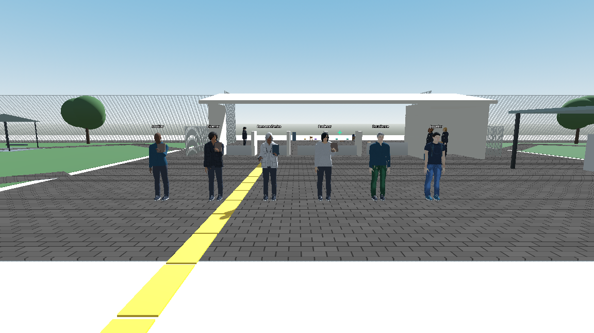

# DuocGames — normalización de altura de personajes

Fecha: 6 de noviembre de 2026.

## Resultado

Se aplicó una altura base humana común desde el sistema visual existente. En la escena Main real, instanciada en una prueba aislada, se verificaron **35 humanos visibles: protagonista y 34 NPC**. Sus alturas neutras finales medidas entre la suela y la coronilla del cuerpo quedaron entre **2,7044 y 2,7091 unidades**: menos de **5 mm de diferencia** entre extremos. Pelo, sombreros, accesorios y posturas no se incluyen en esa definición de estatura.

La referencia anatómica es **2,70 unidades del mundo**. El pequeño margen de la medición renderizada se debe a la geometría del calzado, skinning y pose. No se fuerza una altura constante durante agacharse, caminar, inclinarse, atacar o sentarse: esas animaciones deben seguir cambiando la silueta.

Se conservaron rasgos, sexo/apariencia de los perfiles, ropa, colores, pelo, anchura corporal, accesorios, esqueleto, animación y comportamiento. No se cambiaron misiones, inventario, reglas de combate, Supabase, datos de cuentas, escena principal ni cámara del producto. No se hicieron commits ni push.

## Punto de recuperación previo

Antes de modificar scripts se creó una copia real en:

`recovery/character_height_20261106_155859/` — relativa a la raíz Aethergate.

Contiene **470 archivos**: carpeta scripts del proyecto, Main.tscn, Character.tscn y project.godot, además de un `manifest.json` con rutas y SHA-256. La copia está fuera de Juego para que Godot no importe clases duplicadas del respaldo. No incluye claves de configuración de Supabase ni archivos personales de sesión.

Para deshacer únicamente esta mejora, cerrar la prueba y restaurar desde ese respaldo los cuatro scripts de producto enumerados más abajo, conservando sus rutas. No hace falta git reset ni restaurar todo el árbol, lo que podría sobrescribir trabajo posterior ajeno a esta mejora.

## Qué causaba las diferencias

La altura no tenía una única referencia efectiva. Distintos constructores asignaban escalas visuales independientes:

| Origen | Escala anterior en su constructor | Observación |
|---|---|---|
| Player | 1,5 | Referencia general del protagonista |
| NPC de encargos | 1,4 | Auxiliar, estudiante, profesor, funcionario, técnico y otros |
| Boss académico lógico | 1,15 | Su cuerpo original puede estar oculto por la capa de simulación |
| Director lógico | 1,2 | Diferente del mentor visible creado por la simulación |
| Mentores V4 | 1,0 | La representación educativa visible se creaba sin la escala del protagonista |
| Estudiantes de rutinas/rescate | 1,0 | Diferencia muy evidente frente al protagonista |
| Papelería, guardias y bibliotecaria | 1,5 | Igual escala no garantizaba idéntica altura por morphs distintos |
| Adaptador humano importado | 1,07 adicional | Debía considerarse junto con el factor exterior |

También había morphs de cuerpo/cara que alteraban ligeramente la coronilla, y diferencias entre la superficie física y acabados decorativos elevados. Algunos puntos de aparición estaban aproximadamente 0,12 unidades sobre el suelo. El ajuste anterior del calzado permitía bajar solo 0,06 y no subir el cuerpo completo, por lo que podía dejar un NPC flotando o levantar sus pies sin levantar todo el cuerpo sobre un acabado.

El inventario inicial medía aproximadamente **1,74–2,72 unidades** entre los humanos visibles. Los valores antiguos de `baseline_inventory.json` se obtuvieron con el bake esquelético original del instrumento; en la medición final se incorporaron explícitamente los morphs vivos para evitar subestimar la altura de cuerpos que todavía los conservan.

## Base de personaje y alcance revisado

- El jugador activo se crea en `scripts/juego/player.gd`, desde GameplayManager. No se instancia Character.tscn como su controlador actual.
- La base de representación es `scripts/juego/humanoid.gd`.
- StudentVisual hereda esa base; el protagonista continúa por `main_character_visual_6.gd` y `main_character_visual_6_2.gd`.
- `human_student_6_2.gd` adapta el humano importado del protagonista; `human_npc_6_3.gd` hereda ese adaptador para NPC.
- `npc_visual_6_3.gd` instala los humanos en perfiles elegibles; `character_visual_presets.gd` sigue determinando su apariencia.
- El rig conserva **53 huesos** en los 35 modelos importados comprobados.
- El origen de Humanoid está en los pies. Hips/spine/chest/head y articulaciones siguen controlando las poses.
- Los sockets de armas/objetos se mantienen como los mismos nodos. El adaptador existente continúa colocándolos según la mano del rig.
- El alineamiento existente de gafas, accesorios de cabeza y mochila no se sustituyó.

### Colisiones y escalas raíz

| Personaje o grupo | Colisión encontrada | Decisión |
|---|---|---|
| Protagonista | Cápsula altura 2,7, radio 0,45, centro Y 1,35 | Conservada; coincide con la referencia elegida |
| Guardias | Cápsula altura 2,7, radio 0,35, centro Y 1,35 | Conservada |
| Estudiante rescatado | Cápsula altura 2,5, radio 0,4; capa 0/máscara 1 | Conservada; es un acompañante y se evita alterar su navegación/colisiones |
| NPC de encargos/mentores visibles | Muchos son Node3D sin cápsula bloqueante | No se añadieron colisiones nuevas |
| Bosses lógicos | Cápsulas originales de sus controladores; Director usa visual_scale para su cápsula | Conservadas: pertenecen al objetivo lógico/digital y cambiarlas alteraría combate |
| NEXO | Cápsula y esfera/anillos propios | Fuera de la normalización humana |

Los roots de actores revisados conservan su escala de mundo `(1,1,1)`. La corrección ocurre en el nodo visual. Si una escala heredada cambia, se compensa en el visual para mantener el factor uniforme de mundo, sin cambiar el root físico. No se redimensionaron cápsulas, puertas ni pasillos.

Character.tscn conserva un prototipo de cápsula/malla de 1,7 unidades y scripts antiguos. No es la entrada ni el personaje usado por Main actualmente, por lo que no se migró ni se cambió su controlador. Las escenas históricas de comparación y assets nativos renderizados directamente tampoco se reescribieron: si se reutilizan fuera del sistema compartido, deberán adoptar esa misma base.

## Cómo se corrigió

### Una referencia central

Humanoid define `STANDARD_HUMAN_HEIGHT = 2.7` y `STANDARD_HUMAN_SCALE = 1.5`. Normaliza la escala global del visual conservando su orientación y sin tocar la escala del actor.

La aplicación se realiza al inicializar la base, antes de instalar el humano diferido y antes de animar. Esto evita que una asignación antigua del constructor vuelva a dejar un mentor o un NPC pequeño. No se recalculan mallas por frame: la calibración geométrica se hace al aplicar el perfil.

### Compensación por geometría de cada perfil

El adaptador humano mide la coronilla de la malla Body en su mezcla neutral de morphs y la referencia de suela. Con esa altura y el factor importado 1,07 calcula un **factor uniforme X/Y/Z** para llegar a la referencia común.

El adaptador NPC repite la calibración después de hornear sus rasgos definitivos. Así se mantiene la variación de cuerpo/cara sin usarla accidentalmente como variación de estatura. Es esperable que los factores numéricos de escala de dos modelos sean distintos: sus geometrías de entrada también lo son. Lo unificado es la altura resultante, con escala uniforme en cada modelo.

Al desactivar el humano importado para una apariencia que utiliza el modelo procedural, se restablece la referencia procedural compartida. Se comprobó cambiar a ese fallback y regresar al importado.

### Pies y acabados elevados

Se amplió el margen del resolvedor de contacto que ya existía en `character_footwear_6_3.gd`: admite detectar apoyos hasta 0,25 unidades por encima de la referencia y una compensación visual del cuerpo entre −0,20 y +0,20.

Esto corrige puntos de aparición elevados y permite subir el cuerpo completo sobre acabados que están por encima de la colisión, en vez de elevar solamente los zapatos y acortar visualmente al personaje. La corrección sigue siendo visual; no crea superficies físicas ni mueve la cápsula.

En las 35 muestras neutras, la separación suela/superficie visible quedó entre **−0,00034 y +0,01598 unidades**; habitualmente alrededor de **0,0042**. El instrumento exige menos de 0,02 unidades de separación absoluta en reposo. Los pies de una zancada, salto o ataque no se tratan como si ambos debieran estar siempre apoyados.

## Archivos de producto modificados

| Archivo | Cambio |
|---|---|
| `scripts/juego/humanoid.gd` | Referencia común, compensación de escala heredada y restablecimiento procedural |
| `scripts/juego/human_student_6_2.gd` | Calibración por geometría neutral y restablecimiento al usar fallback |
| `scripts/juego/human_npc_6_3.gd` | Recalibración después de los morphs horneados |
| `scripts/juego/character_footwear_6_3.gd` | Margen del contacto visual existente, incluidas superficies elevadas |

La comparación SHA-256 contra el manifiesto previo identifica **solo esos cuatro cambios entre los 470 archivos respaldados**. Main.tscn, Character.tscn y project.godot permanecen iguales al respaldo.

### Archivos nuevos de prueba y evidencia

- `tests/character_height_check.gd` y `tests/CharacterHeightCheck.tscn`: prueba aislada que instancia Main y utiliza sus controladores reales.
- `reports/character_height/baseline_inventory.json`: inventario previo.
- `reports/character_height/after_inventory.json`: inventario final, alturas, calzado, esqueleto y cápsulas.
- `reports/character_height/checks.json` y `summary.json`: resultados concretos.
- `reports/character_height/gameplay_regression.log`: ejecución de la regresión existente.
- Capturas `six_humans_after.png`, `support_dialogue.png` y `academic_simulation.png`.
- Este informe y el punto de recuperación indicado.

No se agregó un gestor de apariencia alternativo ni un autoload nuevo. La escena de prueba no reemplaza Login ni la campaña de producción; los tests ya están excluidos por la configuración de exportación existente.

## Personajes comprobados

| Muestra solicitada | Identidad del juego | Altura neutra final aproximada |
|---|---|---|
| Protagonista | Player | 2,7087 |
| Estudiante | Estudiante | 2,7087 |
| Profesor | Profesor, encargado de documentos | 2,7089 |
| Boss académico/mentor | profesor_algoritmos | 2,7090 |
| Director | director, mentor visible | 2,7089 |
| Apoyo | Auxiliar | 2,7087 |

También se midieron papelería, bibliotecaria, tres guardias, funcionario, monitor, técnico, estudiante perdido, ayudante de casino, estudiante de rescate, seis civiles por piso y estudiante de laboratorio; mentores de Inglés, Lenguaje, Ética, Datos, Algoritmos, Enfermería, Odontología, Coordinación, Matemáticas, Punto Estudiantil, Chef, Redes y Director. El inventario JSON conserva las identidades y rutas efectivas.

**NEXO** no hereda el humano: representa una esfera con anillos y un controlador propio. Se conservó. Los virus del Director son enemigos digitales pequeños; la política los excluye expresamente. Hologramas de combate, Bugs, proyectiles y efectos digitales tampoco se convierten en personas de 2,70 unidades. Se verificó que una simulación educativa mantiene al mentor humano visible y al objetivo digital por separado.

La alineación de seis personajes se preparó únicamente en memoria dentro de la prueba: no se movieron sus posiciones de producción. Se ocultó el HUD para esa captura y se restauró después. La perspectiva y los gestos pueden alterar la silueta aparente; las medidas provienen del instrumento, no de estimar píxeles.

## Pruebas reales ejecutadas

Se utilizó **Godot MCP Toolkit**, mediante el puente oficial dirigido a la carpeta Juego, para editar/validar GDScript, crear y arrancar la escena de prueba, inspeccionar el runtime y enviar entrada de movimiento. Godot observado: 4.7.2 estable, renderer Compatibility.

La prueba instancia Main con `persist=false`, `test_mode=true` y persistencia de credencial desactivada. El inventario del jugador también queda sin persistencia. Se suspenden rutinas/bloqueos ajenos al objetivo visual y se prepara el destino 2 **solo en la memoria de la prueba** para comprobar el viaje: no es una prueba de desbloqueo normal de campaña ni cambia un guardado real. No se inicializa una sesión Supabase para estas comprobaciones.

| Prueba | Resultado y evidencia |
|---|---|
| Altura de 35 humanos | Aprobada; todas las muestras a menos de 0,04 de la referencia y dispersión real menor de 0,005 |
| Contacto de pies de 35 humanos | Aprobado; separación absoluta menor de 0,02 respecto de superficie visible |
| Sockets finitos de 35 modelos | Aprobado; nodos conservados y transformaciones finitas |
| Caminar con el controlador real | Aprobado; aproximadamente 1,59 m recorridos en la muestra |
| Quieto | Aprobado; sin deriva vertical significativa |
| Atacar mediante entrada | Aprobado; estado ATTACK_LIGHT y animación de golpe activa |
| Scanner de interacción | Aprobado; selecciona al Auxiliar |
| Hablar con NPC de apoyo | Aprobado; modal de diálogo real, sin aceptar la misión |
| Hablar con docente | Aprobado; diálogo de Bases de Datos |
| Simulación educativa | Aprobada; intro, estado COMBAT, holograma y mentor visibles por separado |
| Altura del mentor durante simulación | Aprobada dentro de tolerancia |
| Escaleras con movimiento real | Aprobadas; ascenso observado aproximadamente 1,11 m |
| Ascensor | Aprobado; petición real y viaje al índice 1/piso 2, subida aproximadamente 12,06 m |
| Plataforma y cambio de piso | Aprobados; jugador en Y aproximada 12,059 y piso lógico 2 |
| Entrada de biblioteca con movimiento real | Aprobada mediante entrada MCP: de (−53,5; 12,1; −125) a aproximadamente (−53,46; 12,059; −115,77), unos 9,23 m atravesando el acceso |
| Puertas y pasillos adicionales | Consultas físicas de cápsula aprobadas en corredor 3, acceso de biblioteca y pasillo superior; estas tres son pruebas de espacio, no recorridos continuos |
| Cámara en tercera persona | Aprobada; cámara del gestor activa a unos 5,64 m del origen del jugador |
| Cápsula del protagonista | Aprobada; sigue en altura 2,7 y radio 0,45 |
| Apariencia procedural/importada | Aprobado cambio a fallback y regreso al importado |
| Escala heredada | Aprobada compensación visual con escala temporal de actor 1,1; actor restaurado en la prueba |
| Aislamiento de persistencia | Aprobado |

**Registro final: 127 comprobaciones, cero fallos.** Incluye invariantes individuales de los 35 humanos; no son 127 recorridos humanos independientes. La última comprobación de recorrido por biblioteca se realizó con MCP sobre la misma instancia y está incorporada al script para futuras repeticiones.

Se ejecutó además `tests/gameplay_regression.gd`: resultado `passed=true`, `failures=[]`. Comprueba carga de scripts/escenas, controles, minijuegos, espacio para levantarse, bloqueo de golpes por paredes/pisos y equipar/soltar un arma. Se usa esa suite existente como regresión; no se cambió su código.

Los errores iniciales de tipado durante la edición se corrigieron y los scripts modificados quedaron validados. Una ejecución headless restringida produjo avisos de certificados/registro MCP; la repetición fuera del entorno restringido completó la regresión. Los problemas de comandos de instrumentación se corrigieron antes de aceptar el resultado final: no se atribuyen al juego.

## Límites y pendientes

- Las medidas comparables son de postura neutra, cuerpo sin peinado/sombreros y suela; no prometen una caja visible idéntica durante cada animación.
- Se comprobó la escena Main con sus 35 humanos visibles en esta configuración. No se recorrieron manualmente todos los encuentros, perfiles de vestuario y trayectos de nueve niveles.
- El paso por biblioteca y los viajes/acciones descritos sí ocurrieron en juego; las consultas de espacio adicionales no se presentan como recorridos completos.
- Las transformaciones de sockets pasaron controles y se revisaron mochila/ropa en capturas; no se ensayó visualmente cada combinación de accesorio y cada arma del catálogo.
- No se midió un benchmark comparativo de FPS. La calibración de malla no ocurre por frame, pero el margen de contacto ampliado sigue usando el resolvedor visual existente.
- El prototipo Character.tscn y las escenas/recursos de comparación antiguos que omitan Humanoid quedan fuera de la migración activa. Los humanos creados por el sistema actual comparten la referencia.
- NEXO y entidades digitales conservan sus tamaños por diseño. No son humanos pendientes de normalizar.

## Cómo repetir

Abrir `tests/CharacterHeightCheck.tscn` en Godot y ejecutar esa escena. Esperar `HEIGHT_CHECKS_DONE` y revisar `reports/character_height/summary.json`. Es una prueba aislada con reposicionamiento, suspensión de rutinas y habilitación temporal del destino de ascensor; no una partida del usuario.

Para la regresión existente, ejecutar Godot en modo headless con `--path Juego --script res://tests/gameplay_regression.gd`, guardando el log en la carpeta de evidencia. No ejecutar simultáneamente dos instancias MCP del mismo proyecto si se necesita inspeccionar su runtime: comparten el registro de descubrimiento.
