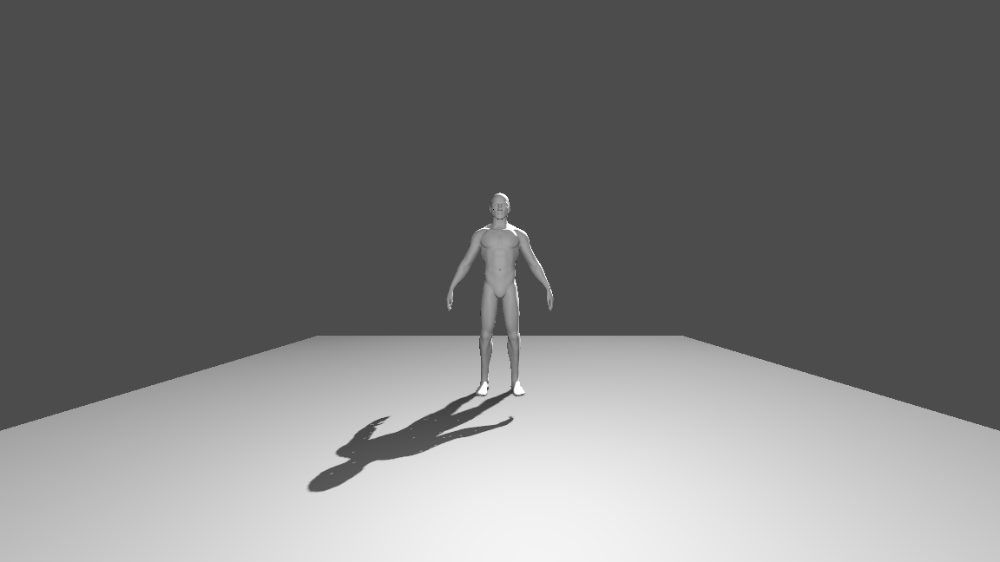
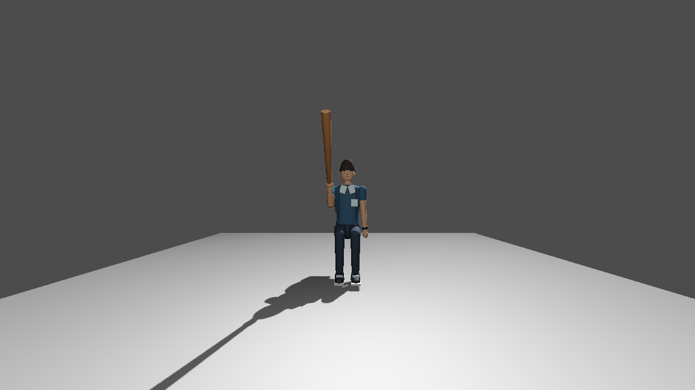

# PILOTO HUMANO REAL 1.0 — resultado

**Asset encontrado e inspeccionado; NO compatible como humano animado en su estado actual.** Se creó únicamente HumanPilot aislado. No se reemplazaron protagonista, NPC ni bosses; no se modificaron balance, armas, economía, misiones ni el GLB original.

## Fuente y estructura real

- Archivo: `res://assets/characters/human_pilot/human_pilot.glb`, 43.856.500 bytes.
- SHA-256: `1175CB7247354F46DE5BF96124246A0ADABAF994F48500D2678F6A3B5A7AA3F6`.
- Metadatos del asset: “Basic male model”, autor ToxicSmoke; declaran CC-BY-4.0. [Fuente declarada](https://sketchfab.com/3d-models/basic-male-model-af32da689e234a26aaf2d267618cadc5), [autor](https://sketchfab.com/ToxicSmoke), [licencia declarada](http://creativecommons.org/licenses/by/4.0/). Se conserva esta atribución; no se descargó contenido ni se verificó externamente la declaración.
- Godot 4.7.2 importa 18 MeshInstance3D / 18 superficies. Geometría base: **1.121.607 vértices / 1.410.404 triángulos**. El importador tiene generación de LOD y shadow meshes activada; los triángulos base no equivalen a primitivas visibles por frame.
- **Skeleton3D: ninguno. Skin: ninguno. Huesos: 0. AnimationPlayer: ninguno. Clips: ninguno.** Los atributos de huesos en todas las superficies están vacíos. No es un problema de nombres equivalentes: el rig no existe.
- No existen Hips, Spine, Chest, Neck, Head, brazos/manos ni piernas/pies que mapear. No se inventaron bindings ni clips y no se riggeó destructivamente el asset.
- Material real único `Scene_-_Root`: albedo blanco, metallic 0, roughness 0,6, doble cara. Sin mapas Albedo/Normal/Roughness/Metallic. No se generaron texturas ni PBR falsos.
- Raíz importada con transformación identidad; conversión de ejes en el hijo Sketchfab_model. AABB importado mínimo (-1,889779; -5,551301; -0,481660), tamaño (3,779567; 7,029681; 1,293066).

Detalles reproducibles por malla en [reports/human_pilot_inspection.json](reports/human_pilot_inspection.json). JSON fuente GLB en [reports/human_pilot_source.json](reports/human_pilot_source.json).

## HumanPilot y escala

`tests/HumanPilot.tscn` usa `tests/human_pilot.gd`, subclase del Player existente. Reutiliza su cápsula y CharacterVisual. Se mantiene sin física/input de gameplay en modo diagnóstico, fuera del grupo player, inventario no persistente y sin emisión de impactos hacia campaña. No se instala en Main ni se guarda como personaje de campaña.

La llamada existente `install_imported_visual(asset, {}, {})` devuelve **false** correctamente: faltan rig y clips. El procedural permanece visible y funcional. `StaticGLBPreview` es una vista explícita de inspección, no un reemplazo animado del CharacterVisual. Nunca se muestran el estático y el fallback como si fuesen un humano animado combinado.

Solo para esa vista estática:

- Escala uniforme: **0,3840857**; altura final 2,7 m para coincidir con la cápsula actual del proyecto. No se cambia la cápsula ni se supone que el campus use un estudiante de 1,8 m.
- Rotación Y: **180°**, comprobada mediante capturas: la fuente mira a +Z y el campus a -Z.
- Offset local aproximado: **(0,00000165; 2,1321752; 0,0633254)**. Pies/borde inferior alineados a Y=0; centro X/Z corregido.
- Ancho final de la pose fija ~1,45 m frente a cápsula de diámetro 0,9 m: los brazos pueden sobrepasar la cápsula. No se certifica paso por puertas o escaleras con esta pose rígida.

## Animaciones, sockets y LookAt

| Prueba | Resultado real |
|---|---|
| Idle / Walk / Run | Sin clips humanos; estados procedurales existentes comprobados |
| Attack | ATTACK_LIGHT procedural comprobado; sin clip humano |
| Death | DEATH procedural comprobado; sin clip humano |
| Sit | SIT procedural comprobado; sin clip humano |
| WeaponSocket | Palo existente visible y conservado en el socket procedural; imposible ligarlo a Hand_R humano ausente |
| BackpackSocket | Mochila procedural conservada; no hay Chest/Spine humano para anclarla |
| HairSocket / HeadAccessorySocket | Soporte existente conservado; no hay Head humano que mapear |
| LookAt | Fallback limitado; yaw observado 0,600715 rad dentro del límite. No hay Head/Neck humano que probar |
| AnimationTree humano | No existe; no se afirma haber conectado clips humanos |
| LOD0/LOD1/LOD2/SLEEP | Reutiliza presupuesto visual del host; distancia y SLEEP comprobados. El estático pierde sombras a distancia y se oculta en SLEEP; no hay un AnimationTree humano cuyo coste medir |

Los estados solicitados se verificaron como poses/transiciones visuales del fallback. El piloto diagnóstico no certifica locomoción física del GLB por puertas/escaleras. La lógica Player existente se reutiliza y permanece separada del modelo.

## Rendimiento en la misma fixture

`tests/HumanPilotCheck.tscn` hereda la fixture anterior: dos cargas de Main, 104 comprobaciones previas y `preview_boss("profesor_ingles")`, misma cámara y vista. NVIDIA GTX 1050, Compatibility/OpenGL, ventana 1152×648, campus ALTO, sombras del sol 40 m. Cuatro muestras a intervalos de 1 s tras 2 s de estabilización por escenario. No se compara headless con renderizado.

| Escenario | FPS (cuatro muestras) | Draw calls capturadas | Primitivas capturadas |
|---|---|---|---|
| A: sin HumanPilot | 65 / 65 / 65 / 65 | 8.380 | ~510.200 |
| B: GLB estático visible, HIGH y sombras | 65 / 64 / 65 / 65 | 8.470 | 5.696.554 |
| C: HumanPilot corriendo con fallback procedural | 64 / 65 / 65 / 65 | 8.612–8.707 | 602.686–638.930 |
| D: GLB estático a distancia | 65 / 65 / 65 / 65 | 8.288–8.317 | 474.800–485.026 |
| E: HumanPilot en SLEEP | 65 / 65 / 65 / 65 | 8.288 | ~474.754 |
| GLB estático MEDIUM | 65 / 65 / 65 / 65 | 8.378 | ~5.661.184 |
| GLB estático LOW, sin sombras propias | 65 / 65 / 65 / 65 | 8.398 | 1.547.434 |

Datos completos: [reports/human_pilot_validation.json](reports/human_pilot_validation.json). Tiempo GPU no disponible. Los NPC y props del fondo siguen animándose: las pequeñas diferencias entre ventanas, incluyendo MEDIUM/LOW, no deben atribuirse exclusivamente a calidad. Se cambió solo calidad/sombras del piloto, no ajustes globales. HIGH/MEDIUM conservan el material real; no existen variantes PBR para simplificar.

La ventana B no mostró una caída sostenida grande de FPS, pero incrementó mucho las primitivas respecto de A. El techo observado ~65 FPS y estas ventanas cortas no demuestran margen GPU ni predicen varios humanos o combates. C mide **procedural**, no un humano GLB animado. D está lejos/fuera de esta vista; no es una prueba de detalle humano visible a larga distancia. No se afirma causalidad exclusiva de diferencias pequeñas ni 60 FPS garantizados.

## Validaciones y uso

Godot-mcp-toolkit ejecutó inspección, capturas, scene de piloto y fixture renderizada. **118 comprobaciones sin fallos: 104 existentes + 14 del piloto**, incluyendo rechazo seguro, seis estados fallback, palo/mochila, mirada limitada, distancia/SLEEP y protagonista intacto. Los tres scripts nuevos pasaron script_check. No se modificó ningún script de producción en esta etapa.

Para revisar: ejecutar `tests/HumanPilot.tscn` con F6. Los botones permiten ver el GLB estático o Idle/Walk/Run/Attack/Death/Sit procedurales. Es una escena de diagnóstico; no es una nueva mecánica de campaña ni un protagonista humano terminado.

## Recomendación y pendientes

**No pasar este modelo al protagonista todavía.** Sirve como referencia estática, no como base animada lista. Antes hacen falta rig humanoide, skinning/pesos, IDLE/WALK/RUN in-place reales, revisión de malla/retopología y presupuesto de superficies/LOD. Attack/Death/Sit y demás clips se mapearán solo si existen; lo demás conservará fallback. Después validar hand/chest/head bindings con mochila/arma y realizar medición con ese rig real antes de convertir UN NPC adicional. No se autoriza ni realiza reemplazo masivo.

PENDIENTE DE PRUEBA MANUAL:

- [ ] Revisar frontal/lateral/espalda, pies, manos, cabeza y proporciones de la vista estática.
- [ ] Revisar los seis estados procedurales y clipping del palo/mochila en la escena aislada.
- [ ] Evaluar altura visual de 2,7 m frente al campus actual; puertas, cámara y escaleras requieren recorrido real cuando haya rig compatible.
- [ ] Probar rig/clips/sockets/LookAt humanos después de suministrar un asset riggeado.
- [ ] Medir duelos completos y otros equipos/resoluciones antes de aceptar su densidad de geometría.

Ninguna casilla manual se marca PASS por el resultado automático.
