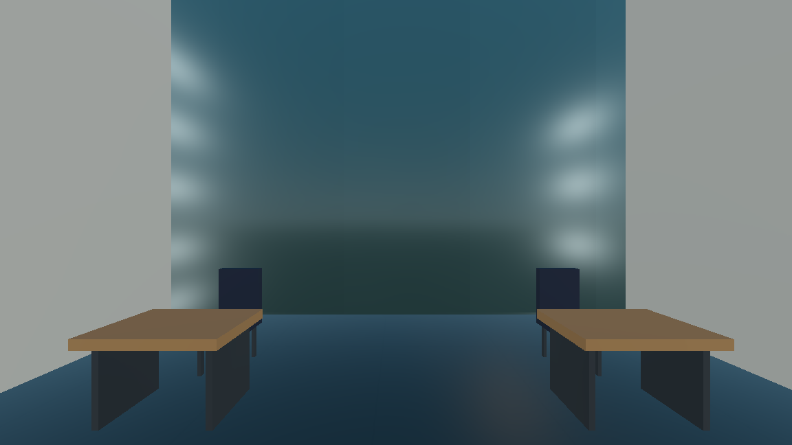
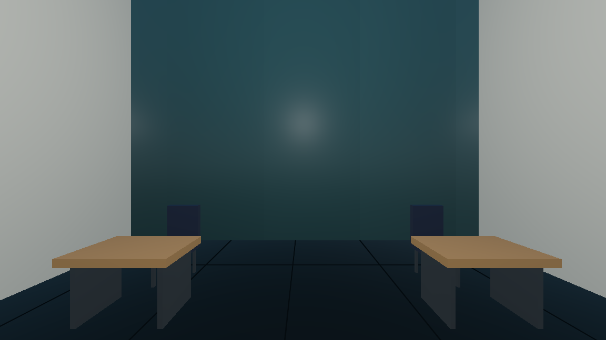
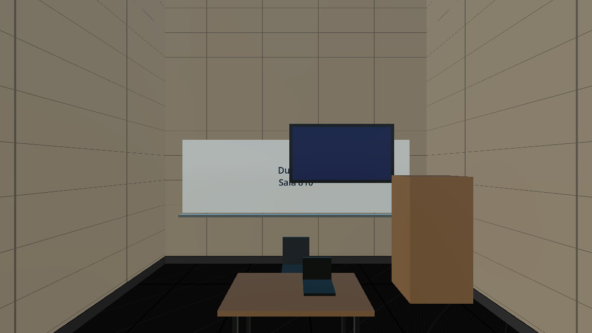
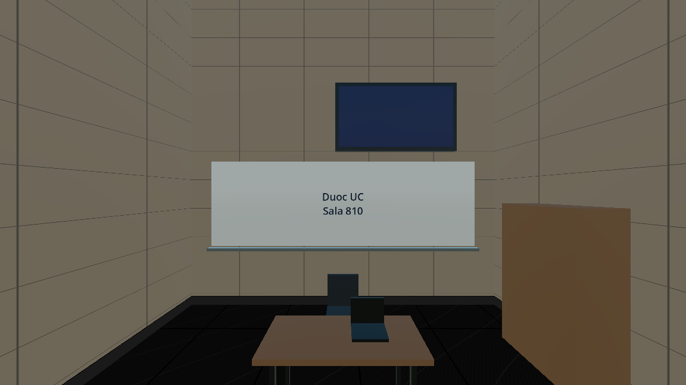
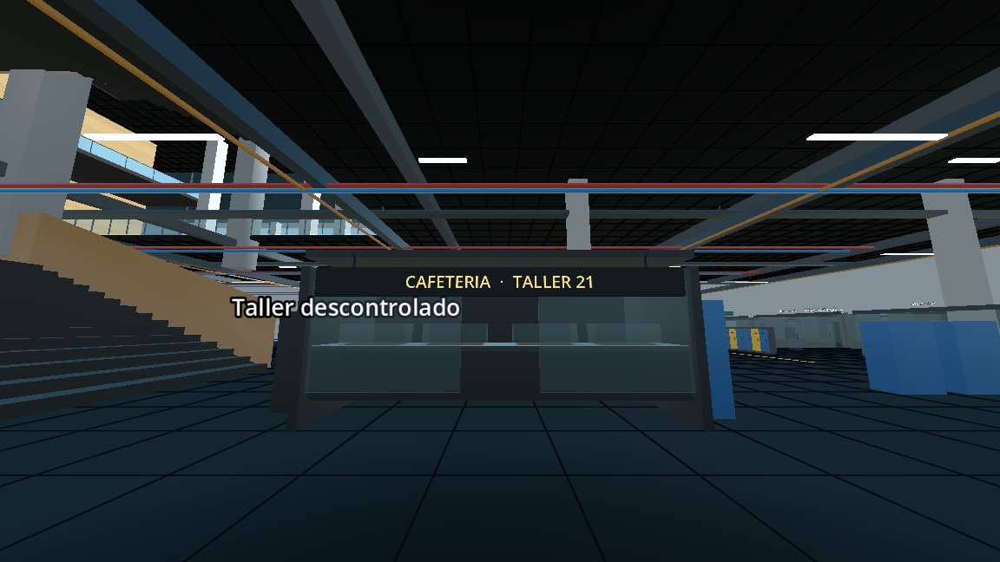
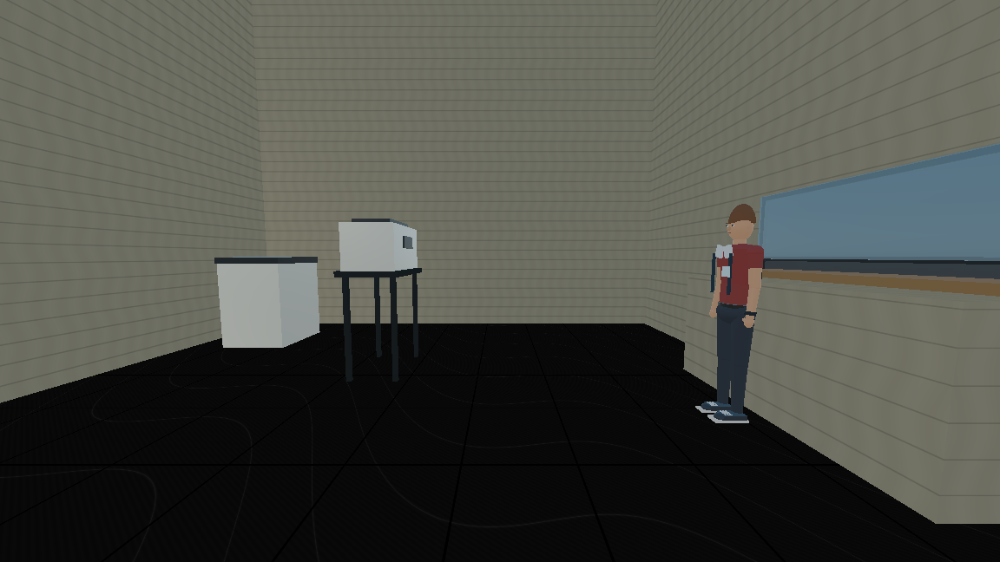

# DuocGames 5.0 — remodelación visual

Fecha de trabajo: 2026-11-05. Proyecto actual: `Juego`. Motor observado: Godot 4.7.2, GL Compatibility.

## Resultado y límites

Se implementaron correcciones en las escenas y materiales reales. Se inspeccionaron capturas actuales de los nueve niveles, 73 sectores del inventario previo, dos vistas exteriores y vistas adicionales de ascensores, puertas de emergencia y cafetería. Las cámaras se trasladaron para inspección: esto **no equivale a caminar físicamente todas las rutas**.

Hay **27 incidencias tratadas**, contando 15 luces de alcance global, tres pantallas que tapaban pizarras, tres armarios que ocultaban su borde, un cartel sin soporte, una impresora sin apoyo y cuatro shaders con respuesta especular excesiva. Además se ajustaron **72 luces académicas** al blanco neutro solicitado; este ajuste de estilo se cuenta aparte. No se afirma que se hayan localizado todos los defectos individuales del campus.

La revisión general dispone de **148 pares de capturas antes/después**. Se añaden 24 vistas únicas posteriores para cafetería, circulación, auditorio y papelería. Hay tomas repetidas de comprobación; no son sectores adicionales. La inspección comprende aulas, talleres, laboratorios, biblioteca, casino, oficinas, baños, terraza, auditorio, estudio y exterior. Las tomas obstruidas se identifican como tales, sin atribuir automáticamente el problema al mobiliario.

## Recuperación y protección del trabajo previo

- Punto inicial: `../recovery/before_visual_remodel_5_0/`, 831 archivos verificados con SHA-256 y estado Git previo. Es una copia de fuentes, escenas y recursos de texto; excluye configuración privada, guardados personales, binarios y texturas. Los assets existentes se conservaron.
- Se usó el **puente oficial de godot-mcp-toolkit** dirigido explícitamente a `Juego`, con el editor en el puerto 6550. La conexión integrada dirigida a `Aethergate` devolvía `AUTH_FAILED`; no se cambiaron credenciales.
- La sesión de capturas instancia `Main` con persistencia de campaña y credencial del Director desactivadas y `test_mode` habilitado.
- El guardado completo del editor activó generadores `@tool` que reserializaban elementos ajenos al cambio. Ese resultado se rechazó y se conservó en `../recovery/visual_5_editor_serialization.tscn`. Los cambios finales se reaplicaron de forma selectiva sobre la copia inicial verificada.
- Evidencia de las diferencias finales: `reports/visual_5/scene_diff.json` y `curated_patches.json`. Se conservan los identificadores persistentes y las formas de colisión. Tres armarios estáticos se trasladan con su cuerpo hijo; por tanto sus colisiones cambian de **ubicación**, no de forma ni funcionamiento.
- No se modificaron historia, misiones, campaña, combate, inventario, Supabase, autenticación, roles, preguntas, economía ni lógica del Director. No hubo push.

## Registro de incidencias y correcciones

| ID | Piso / sector / objeto | Evidencia y corrección | Estado |
|---|---|---|---|
| V01 | 1–8, `Iluminacion/LuzNorte` y `LuzSur`; 15 nodos existentes | Alcance 4096 m sin sombras y reflejos repetidos entre niveles. Se comparó una sesión candidata y se desactivaron esas luces de relleno antiguas. Se limita también su alcance almacenado a 16 m para una eventual reactivación consciente. Los nodos no se borran ni se presentan como duplicados. | PASS VISUAL en las vistas comparadas |
| V02 | 6–8, seis salas por nivel, cuatro `LuzInterior*` por sala | 72 luces pasan de `Color(1, 0.93, 0.83)` a `Color(1, 0.98, 0.95)`. Sin luces nuevas, cambios de energía ni nuevas sombras. | PASS VISUAL, ajuste tonal |
| V03 | 6/610, 7/710, 8/810; `PantallaProyeccion` e `ImagenProyector` | Superposición visible sobre la pizarra. Altura local 2.45 → 3.6 m; el borde inferior queda por encima del área de escritura. Conservan tamaño, materiales y ubicación en la pared. | PASS VISUAL |
| V04 | Las mismas tres salas; `ArmarioMateriales` | El armario seguía ocultando el borde derecho de la pizarra. Se apoya junto a la pared lateral: posición local `(2.65, 1, -6.7)`, giro de 90°. Se conserva el nodo con su cuerpo y forma de colisión. No es una silla recogible ni un objeto de misión. | PASS VISUAL; recorridos automáticos en resultados de pruebas |
| V05 | −1, negocio/cafetería; `LetreroCafeteria` | Texto sin soporte, visible invertido desde el reverso. Se instala una placa mate reutilizable con dos soportes a la marquesina. El texto queda separado 15 mm de la cara de la placa. Se conserva literalmente `CAFETERIA · TALLER 21`. El reverso opaco oculta la escritura invertida. | PASS VISUAL, frente y reverso |
| V06 | Suelos interiores, terraza y pasillos altos; tres shaders existentes | Se suaviza el brillo y se diferencian juntas y superficie mediante roughness. Sin aumentar resolución de texturas ni añadir mapas o geometría. | PASS VISUAL en las vistas comparadas |
| V07 | Vidrio tintado de fachada y superficies que lo reutilizan | Se reduce la respuesta metálica y el brillo puntual: metallic 0, roughness 0.4, specular 0.35. Se conservan color, geometría y patrón existente. | PASS VISUAL, reflejos reducidos |
| V08 | Piso 2, papelería; `Impresora` | La vista libre mostró el equipo suspendido: su base está a 1.9 m y el mostrador existente fue trasladado al frente. Se añade una mesa visual, con cubierta que llega exactamente a 1.9 m y cuatro patas apoyadas en el suelo. Se conserva la impresora con su colisión, bandeja y pantalla. No se añade ninguna colisión. | PASS VISUAL, vista libre final |

### Materiales

| Recurso existente | Ajuste |
|---|---|
| `materials/entrance/piso_interior_oscuro.gdshader` | Cerámica satinada, roughness 0.64–0.90 según junta, metallic 0, specular 0.25. |
| `materials/entrance/piso_fotos.gdshader` | Roughness 0.64–0.90, specular 0.25; se conserva el tratamiento de caras verticales y luminosidad previa. |
| `scripts/pisos/piso_8/baldosas_oscuras.gdshader` | Roughness superficial 0.62–0.68 y juntas 0.90. |
| `materials/entrance/vidrio_fachada_duoc.gdshader` | Vidrio dieléctrico con reflejo menos agresivo. |
| `materials/entrance/MAT_Sign_Backplate_5.tres` | Nuevo material compartido de placa y soportes: grafito mate, roughness 0.9. |

No se descargaron assets. No se añadieron normal maps sin una fuente compatible y comprobada. Las coordenadas mundiales de los shaders existentes se conservan para evitar estirar texturas al cambiar el tamaño de las superficies.

## Revisión por piso

| Nivel | Sectores fotografiados y trabajo realizado |
|---|---|
| −1 | Negocio, ping-pong y mesas, casilleros al fondo, salas técnicas, mecánica, soldadura, maquinaria y entorno de NEXO. Cartel de cafetería con soporte. Se mantiene mecánica a la izquierda y negocio a la derecha según el sentido de salida del ascensor, sin mover sectores. |
| 1 | Punto Estudiantil, casino, capilla, coordinación y reunión. Se reduce el reflejo excesivo de superficies compartidas y se neutraliza el relleno global. Casino conserva su iluminación cálida propia. |
| 2 | Biblioteca, papelería y auditorio. Se reduce el brillo del piso; se conserva iluminación de lectura y luz cálida del auditorio. Se repiten vistas libres y se confirma y corrige la falta de apoyo de la impresora. Se añaden vistas desde el pasillo del auditorio y el escenario. |
| 3 | Local existente, sala posterior y laboratorio de informática. Se conserva la ampliación, equipos y cableado; ajuste de materiales compartidos y relleno global. |
| 4 | Áreas norte, docentes, salas centrales y frente de oficinas. Los reflejos verticales sobre el vidrio disminuyen. No se redistribuyen las áreas de salud ni profesores. |
| 5 | Terraza y tienda. Suelo menos especular; se conserva mobiliario, tienda y referencias. |
| 6 | Seis salas y ambos baños, ascensores y emergencia. Luz académica neutra; pantalla y armario de 610 corregidos. |
| 7 | Seis salas y ambos baños, ascensores y emergencia. Luz académica neutra; pantalla y armario de 710 corregidos. |
| 8 | Seis salas y ambos baños, ascensores y emergencia. Luz académica neutra; pantalla y armario de 810 corregidos. Director, computadores de misión y simulación conservados. |
| Exterior | Entrada, pabellón frontal y costado. Vidrio compartido menos especular; no se añadieron detalles institucionales ni se alteraron accesos o volumetría. |

La carpeta contiene tomas de puertas de emergencia y vestíbulos de los nueve niveles. Una imagen de una puerta abierta no certifica por sí sola la transitabilidad; se complementa con regresiones físicas.

## Duplicados, muebles interactivos y arquitectura

**Duplicados eliminados: 0.** No se demostró una pieza duplicada cuya retirada fuera segura. No se confundieron las instancias compartidas de los pisos 6–8 con duplicación accidental. Tampoco se borraron luces: se deshabilitaron las 15 de alcance global.

**Sillas, armas y objetos de misión trasladados: 0.** Solo se trasladan tres armarios estáticos y tres conjuntos de proyección visual. Las dos piezas de cada pantalla permanecen alineadas. Ningún `world_id` se reasigna.

**Formas de colisión modificadas: 0.** Se trasladan tres colisiones existentes junto a los armarios. No cambian paredes, escaleras, puertas, checkpoints, salas ni rutas de campaña. Los ocho elementos visuales nuevos (tres de cartelería y cinco de la mesa de impresora) carecen de colisión. La mesa se añade bajo el equipo existente y no cambia el acceso de campaña.

## Rendimiento medido

Fuente: `reports/visual_5/performance_comparison.json`; muestras crudas en `before_views.json` y `after_views.json`. Mismas 148 posiciones, objetivos, FOV 85°, resolución 1152×648, renderizador Compatibility y 30 muestras por vista. HUD oculto y jugador detenido en ambos casos. Las tomas de las tres salas con armarios se repitieron después de la última corrección.

| Mediana de las muestras comparadas | Antes | Después |
|---|---:|---:|
| FPS informados por Godot | 41 | 42 |
| Tiempo de frame (ms) | 19.92 | 18.48 |
| Draw calls | 8791.5 | 8808 |
| Primitivas renderizadas | 446223 | 446217 |
| Luces habilitadas y con energía en el árbol completo | 517 | 502 |

El contador de primitivas de Godot se registra sin convertirlo a un conteo independiente de triángulos; no se realizó una captura de GPU que distinga topologías. Las luces habilitadas tampoco equivalen a las luces que el renderizador aplica a cada objeto.

La mediana general de FPS fue mayor en esta sesión; **no se demuestra una mejora estable de FPS**. El editor y las rutinas de NPC no son una carga perfectamente reproducible; el editor tenía Login abierto al inicio y Main en las comparaciones posteriores. Por tanto las muestras sirven como observación del recorrido, no como benchmark controlado. Pisos 2 y 3: 44→39 y 44→28 FPS; piso 1: 32→31 FPS. El piso 4 registra 25.93 ms por frame y sigue siendo un sector pesado. No se ocultan las variaciones ni se interpretan como una optimización garantizada.

No se tocaron LOD, SLEEP, reducción de sombras, optimización del HUD ni geometría compartida. Se añaden únicamente ocho piezas simples de placa, soportes y mesa de impresora, con un material compartido; no se crean luces nuevas. El soporte de impresora usa cinco cajas CSG sin colisión, en consonancia con el mobiliario existente de esa sala.

## Pruebas y estados

Los resultados ejecutados están en `reports/visual_5/regressions.json`, con logs por suite. El registro inicial `regressions_sandbox_attempt.json` conserva los intentos con error del almacén de certificados de Windows; no se presentan como aprobados. La ejecución final se repite fuera del sandbox y con simulación fija a 60 FPS.

La tabla detallada de resultados finales se genera al cerrar las comprobaciones y aparece al final del documento.

**PASS VISUAL:** comparación de reflejos en los sectores fotografiados, pantallas/pizarras de 610/710/810, posición lateral de armarios, placa de cafetería por ambos lados, carga visual de los nueve niveles y exterior.

**PENDIENTE MANUAL:** revisión humana de fidelidad fotográfica de cada recinto, legibilidad de toda la señalización desde la cámara normal del jugador, cobertura de esquinas no visibles en las tomas, luminarias que pudieran filtrar luz entre paredes por no usar sombras, y recorrido completo con una cuenta real. Las pruebas con fixtures de guardado no certifican escritura remota en Supabase.

**PASS AUTOMÁTICO Y VISUAL de cámara:** `placement_stairs_visual_check.gd` se canceló inicialmente en modo headless porque espera `frame_post_draw`. Se repitió con renderizado real y terminó sin fallos, con cinco capturas de personaje, escaleras y recogibles. `rendered_gameplay_check.gd` también pasó sus 14 comprobaciones. Se inspeccionaron las capturas de la silla apoyada y del personaje en el descanso. Las imágenes MCP de puertas no sustituyen esos resultados.

## Pendientes encontrados o no certificables

1. Permanecen reflejos locales suaves y algunas diferencias de iluminación; deshabilitar el relleno global no resuelve toda posible filtración entre habitaciones. No se habilitaron cientos de sombras para ocultarlo.
2. Se completaron las vistas desde pasillo y escenario del auditorio. Los rótulos de entrada se ven invertidos desde el reverso en la toma interior. Se deja pendiente revisar la cara de acceso y el montaje de esas placas antes de cambiar su orientación o añadir señalización interior.
3. Se completaron las vistas libres de papelería y se corrigió el apoyo de la impresora. La obstrucción de la primera cámara se debía a su cercanía a la silla; no se trasladó esa silla.
4. Las salas centrales del piso 4 muestran aperturas superiores al atrio. Se conservan hasta contrastarlas con una referencia suficiente: cerrarlas automáticamente alteraría la arquitectura.
5. El revestimiento/celosía exterior sigue mostrando patrones finos a distancia. Su corrección requiere comparar la fotografía y el recorrido real, manteniendo la fachada y su rendimiento.
6. Se inventariaron 871 `Label3D`, incluyendo señales, etiquetas de interacción, NPC y elementos de campaña. No se certifica individualmente la correcta fijación de cada uno. No se tocaron indicadores de misión para convertirlos en carteles arquitectónicos.
7. No se identificaron texturas fotográficas adicionales con normal maps y licencia comprobada para reemplazar acabados. Se mejoraron los materiales existentes.

Estos puntos son pendientes explícitos; esta entrega **no certifica una remodelación exhaustiva de cada objeto del campus**.

## Referencias y archivos

- Geometría y nomenclatura de `Main.tscn`, la escena compartida `PasilloReferencia.tscn` y `AGENTS.md`.
- Capturas actuales guardadas en `reports/visual_5/`; el inventario del recorrido anterior se usó para obtener puntos de cámara, pero las imágenes de validación son nuevas.
- Fotografía existente `materials/piso5/referencia_tienda.jpeg`, consultada para conservar el aspecto de tienda, escaleras y acabados. No se inventaron otras fotografías ni nombres institucionales.
- `reports/visual_5/before_contact_*.jpg` y `after_contact_*.jpg`: hojas de contacto. Las capturas originales PNG conservan resolución completa.

**Producción:** tres scripts GDScript modificados (constructores visuales), dos escenas modificadas, cuatro shaders modificados y un material nuevo. Se añaden herramientas de inspección y comprobación bajo `tests/` y una escena de prueba, que no se incorporan al flujo de login ni al menú del juego. Los scripts y escenas se cuentan por archivo, no por cada una de las tres instancias de la escena compartida.

**Herramientas de esta entrega:** un GDScript de inspección, siete scripts CJS y un PowerShell: nueve scripts auxiliares. En total se crearon o editaron 16 archivos de script/shader y tres escenas (dos de producción modificadas y una escena de inspección nueva). Los `.uid` generados por Godot y los informes/capturas no se cuentan como scripts.

**Balance de pruebas:** 20 configuraciones de prueba aprobadas (14 regresiones, cuatro escenas de accesos y dos pruebas renderizadas). Tras añadir la mesa de impresora se repitieron otras cuatro comprobaciones de carga, colocación, biblioteca y referencias: también aprobadas. No hay FAIL funcional en las ejecuciones finales. Los intentos cancelados o limitados durante la preparación no se usan como evidencia de aprobación.

Para reproducir la inspección, iniciar `res://tests/VisualInspection5.tscn` mediante MCP y llamar `survey()` en el nodo raíz. `reports/visual_5/phase.txt` selecciona el prefijo de capturas. No ejecutar `visual_apply_curated_5.cjs` después de incorporar trabajo nuevo: es la herramienta de reaplicación de esta sesión y toma como base su punto de recuperación.

<!-- GENERATED_RESULTS -->

## Resultados finales ejecutados

| Prueba | Estado | Evidencia |
|---|---|---|
| gameplay_regression | PASS AUTOMÁTICO | Exit 0; errores de motor 0; 4.9 s |
| inventory_regression | PASS AUTOMÁTICO | Exit 0; errores de motor 0; 0.9 s |
| organizacion_pisos | PASS AUTOMÁTICO | Exit 0; errores de motor 0; 4.9 s |
| placement_visual_check | PASS AUTOMÁTICO | Exit 0; errores de motor 0; 6.8 s |
| library_layout_check | PASS AUTOMÁTICO | Exit 0; errores de motor 0; 5.2 s |
| campaign_regression | PASS AUTOMÁTICO | Exit 0; errores de motor 0; 9.6 s |
| piso8_recorridos | PASS AUTOMÁTICO | Exit 0; errores de motor 0; 25.4 s |
| piso8_recorridos_floor6 | PASS AUTOMÁTICO | Exit 0; errores de motor 0; 24.0 s |
| piso8_recorridos_floor7 | PASS AUTOMÁTICO | Exit 0; errores de motor 0; 25.1 s |
| salidas_emergencia | PASS AUTOMÁTICO | Exit 0; errores de motor 0; 6.5 s |
| guardado_lectura | PASS AUTOMÁTICO | Exit 0; errores de motor 0; 0.7 s |
| cloud_save_check | PASS AUTOMÁTICO | Exit 0; errores de motor 0; 0.6 s |
| persistent_queue_v4 | PASS AUTOMÁTICO | Exit 0; errores de motor 0; 0.7 s |
| resource_reference_check | PASS AUTOMÁTICO | Exit 0; errores de motor 0; 11.9 s |
| scene:tests/BasementAccessCheck.tscn | PASS AUTOMÁTICO | Exit 0; errores de motor 0; 24.2 s |
| scene:tests/ElevatorBasementCheck.tscn | PASS AUTOMÁTICO | Exit 0; errores de motor 0; 12.0 s |
| scene:LibraryAccessCheck.tscn | PASS AUTOMÁTICO | Exit 0; errores de motor 0; 18.0 s |
| scene:AuditorioAccessCheck.tscn | PASS AUTOMÁTICO | Exit 0; errores de motor 0; 16.9 s |
| placement_stairs_visual_check | PASS AUTOMÁTICO | Exit 0; errores de motor 0; 20.9 s |
| rendered_gameplay_check | PASS AUTOMÁTICO | Exit 0; errores de motor 0; 23.3 s |
| organizacion_pisos | PASS AUTOMÁTICO | Exit 0; errores de motor 0; 4.9 s |
| placement_visual_check | PASS AUTOMÁTICO | Exit 0; errores de motor 0; 5.9 s |
| library_layout_check | PASS AUTOMÁTICO | Exit 0; errores de motor 0; 5.2 s |
| resource_reference_check | PASS AUTOMÁTICO | Exit 0; errores de motor 0; 9.7 s |

Los PASS de guardado de nube y cola persistente usan fixtures: la base remota no se probó. Los PASS visuales automatizados se complementan con inspección de las capturas; no sustituyen una revisión humana de todo el campus.

## Capturas seleccionadas

| Sector | Antes | Después |
|---|---|---|
| Vidrio y reflejos, piso 4 |  |  |
| Pizarra y armario, sala 810 |  |  |

Cartel de cafetería instalado, vista frontal posterior:

Soporte de impresora (par adicional desde la misma cámara):

| Antes | Después |
|---|---|
|  |  |
