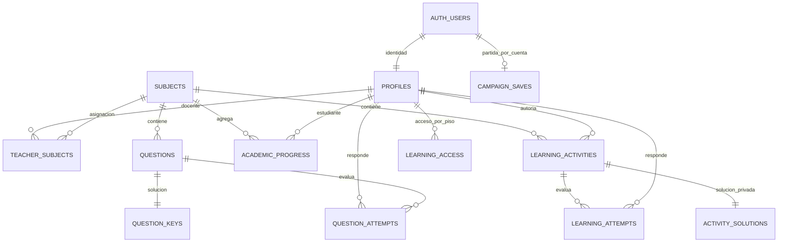

# Base de datos — evidencia y límites

Auditoría del 6 de noviembre de 2026. **No hay tablas remotas confirmadas en esta sesión.** La prueba GET de solo lectura, sin usuario autenticado, terminó en DNS `ENOTFOUND`, incluso fuera del sandbox. [Resultado](remote_readonly.json). No se distingue mediante ese fallo si un recurso no existe, está vacío, tiene RLS o no es accesible. No se aplicaron migraciones ni seeds ni se modificaron cuentas.

## Tres fuentes distintas

1. **Confirmado localmente:** JSON de práctica, 150 preguntas/10 áreas/11 perfiles; contadores de campaña y migración local probados. No son tablas PostgreSQL.
2. **Confirmado en repositorio:** DDL, claves, políticas y RPC de `supabase/migrations/001_education_auth.sql` a `009_learning_audit_v4.sql`; adaptadores HTTP en `scripts/auth` y `scripts/education`. Esto confirma intención e implementación cliente/SQL, no despliegue.
3. **Pendiente remoto:** versión instalada de migraciones, tablas/columnas efectivas, filas, cantidades activas, roles reales, grants y RLS ejecutada. Las fixtures modelan reglas y no sustituyen una prueba con PostgreSQL/Supabase.

## Diccionario del esquema de migraciones

| Tabla en SQL local | Clave y relación | Campos relevantes / finalidad | Evidencia |
|---|---|---|---|
| `auth.users` | UUID `id`, sistema Supabase Auth | Identidad gestionada externamente; el proyecto no crea su DDL | Referenciada en 001 y 007; existencia desplegada no verificada |
| `public.profiles` | `id` PK/FK → auth.users.id | email, display_name, avatar_url, role, fechas | 001, reparaciones 002–004 |
| `public.subjects` | UUID `id` PK; `code` único | name, floor, area, active | 001; RPC administrativo 009 |
| `public.teacher_subjects` | PK compuesta teacher_id/subject_id; FKs a profiles/subjects | Relación N:M docente/asignatura | 001 y 004 |
| `public.questions` | UUID `id`; FK subject_id → subjects; created_by → profiles | question_text, option_a…d, floor, difficulty, active | 001, API heredada conservada |
| `public.question_keys` | question_id PK/FK → questions | correct_option A…D y explanation | 001, lectura restringida |
| `public.question_attempts` | UUID `id`; student_id → profiles; question_id → questions | selección, resultado, contexto, fecha | 001, validación RPC 004 |
| `public.academic_progress` | PK student_id/subject_id; ambas FKs | answered, correct, incorrect, updated_at | 001 |
| `education_private.question_tickets` | student_id PK/FK; question_id FK | contexto y expiración; emisión de una pregunta | 001 |
| `public.admin_audit_log` | UUID `id`; admin_id y target_user_id → profiles | action, old_role, new_role, details JSONB, fecha | 004, ajuste 006, eventos de 009 |
| `public.campaign_saves` | user_id PK/FK → auth.users | payload JSONB, previous_payload, revision, request_id, fecha | 007 |
| `public.learning_activities` | UUID `id`; subject_id → subjects; created_by → profiles | unit, kind, prompt, content JSONB, image_path, difficulty, active, access_challenge, mentor_id, retry_delay_seconds, max_attempts_per_day | 008 |
| `education_private.activity_solutions` | activity_id PK/FK → learning_activities | answer JSONB y explanation; no están en el documento estudiante | 008 |
| `education_private.activity_tickets` | user_id PK/FK → profiles; activity_id FK | contexto, expiración, versión updated_at | 008 |
| `public.learning_attempts` | UUID id; user_id → profiles; activity_id → learning_activities | correct nullable para reflexión, context, is_training, fecha | 008 |
| `public.learning_access` | PK user_id/floor; user_id → profiles; activity_id FK nullable | autorización por piso y educational_xp | 008 |

La vista privada `learning_attempt_stream_v4` de 009 unifica intentos antiguos y nuevos para estadísticas. El bucket `educational-images` y políticas de `storage.objects` aparecen en 008; no es una tabla de negocio creada por el juego y su despliegue está pendiente de comprobar.

Diagrama conceptual de las migraciones; no prueba cardinalidades presentes en datos reales. Tablas de tickets/auditoría omitidas del dibujo para legibilidad, incluidas en el diccionario.

## Roles y permisos escritos

- 001 comenzaba con student/teacher/admin; **004 cambia el valor predeterminado a pending** y añade ese rol. No describir el esquema final usando solo 001. El cliente tiene ruta PendingAccountScreen.
- El rol se consulta por `auth.uid()` y perfil del servidor; la interfaz no debería otorgarlo. Las funciones administrativas verifican admin. 005/006 corrigen su manejo y firma. El modelo de pruebas rechaza un rol falsificado por el cliente, pero RLS real sigue pendiente.
- Docente: asignaturas asignadas por teacher_subjects, autoría y restricciones de edición. Administrador: gestión amplia mediante RPC y auditoría. Estudiante: contenidos activos autorizados, sin lectura de soluciones privadas.
- `questions` y `question_keys` tienen políticas separadas. Las actividades nuevas guardan soluciones en `education_private`, sin grants de lectura directa para estudiantes.
- `get_random_question` / `submit_answer` y `get_learning_activity` / `submit_learning_activity` emiten y consumen tickets; las claves se evalúan en SQL para el flujo publicado. Contexto, expiración, repetición y cambios de versión forman parte de las reglas escritas.
- `save_learning_activity` valida tipo, alternativas/contenido, rol, asignatura y ubicación/mentor. No se agregaron columnas para el banco local. Sus campos `answer`/`explanation` deben separarse mediante la RPC al publicarse; no se sube el JSON local directamente como fila pública.
- `campaign_saves` permite lectura propia; escritura por `save_campaign`. La función serializa por cuenta, compara revisión, usa request_id idempotente y conserva previous_payload cuando se solicita. Eso protege concurrencia prevista; **no convierte el guardado JSON del cliente en un sistema antitrampas**.
- No hay borrado físico de preguntas en el panel actual. No confundir desactivar con eliminar. Las pruebas no borraron filas reales.

## Asignaturas y preguntas nuevas

El seed `supabase/seeds/001_subjects.sql` enumera **INF_GENERAL, BASE_DATOS, ALGORITMOS, REDES, INGLES, ETICA, COMUNICACION, MATEMATICAS, ENFERMERIA y ODONTOLOGIA**. Estos son códigos del repositorio, no confirmación de filas remotas ni una malla curricular oficial.

El banco [capstone_practice_bank.json](../../resources/education/capstone_practice_bank.json) conserva ese vocabulario. UUID locales deterministas: no coinciden necesariamente con UUID creados por `gen_random_uuid()` en un servidor. El archivo [publication_pending.json](publication_pending.json) deja `remote_subject_id: null` para evitar suponer esa asociación.

Coordinación y Director reutilizan referencias cruzadas del banco local. Su publicación requiere validar las restricciones reales de mentor/piso; copiar preguntas y cambiar subject_id para eludirlas sería incorrecto. El panel y SQL existentes se conservaron.

## Verificación remota pendiente, sin ejecución en producción

Cuando exista un staging expresamente autorizado: revisar historial de migraciones y catálogo con permisos adecuados; contrastar las 16 tablas del diccionario incluyendo auth.users y las tres tablas privadas; revisar grants/policies; crear identidades temporales pending/student/teacher/admin; comprobar acceso permitido y denegado con sus JWT; resolver subject_id y created_by reales; publicar mediante RPC idempotente sin sobrescribir autorías; verificar alternativas, evaluación, permisos y guardado; limpiar solo fixtures temporales. Esta lista es un paso pendiente, no una autorización ni una ejecución realizada.

No se incluyen contraseñas, tokens, claves privadas, URL del proyecto o identificadores de usuarios reales.
